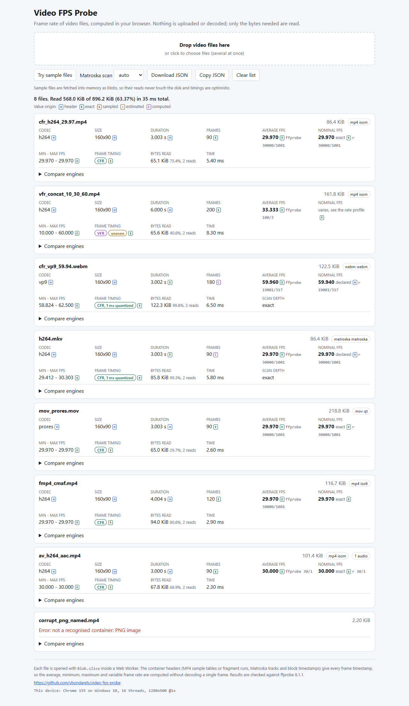
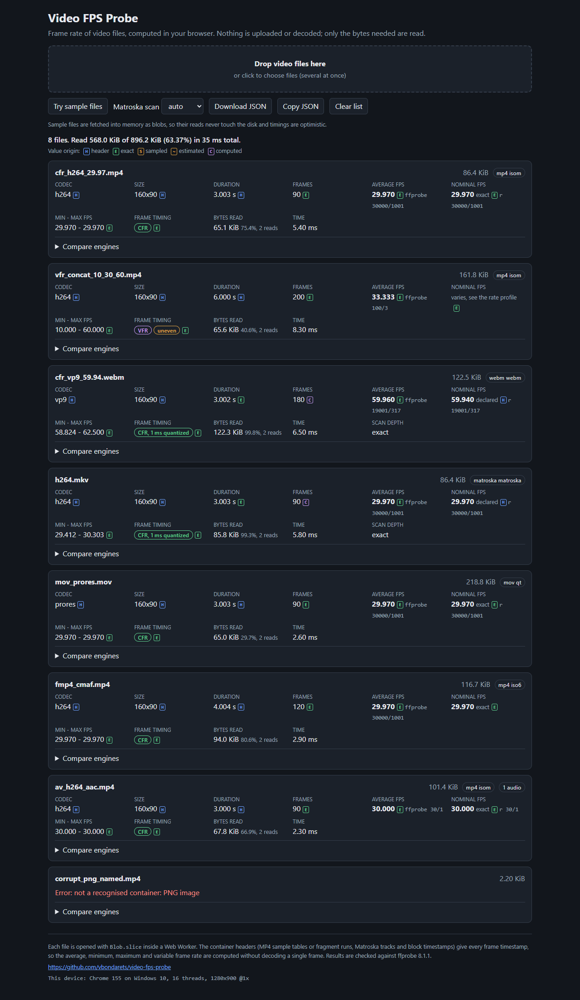
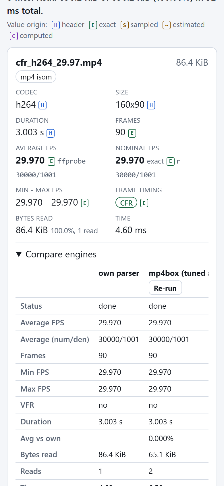
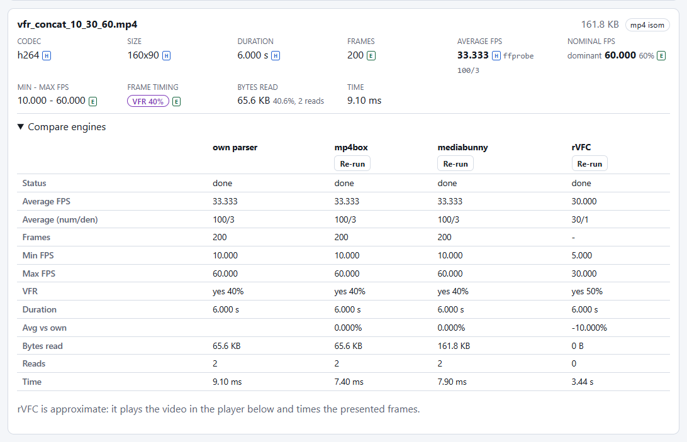

# Video FPS Probe

Frame rate, frame count and variable frame rate detection for local video files, computed in the browser from the container headers. Nothing is uploaded or decoded, and the results are checked against ffprobe 8.1.1.

**[Live demo](https://vbondarets.github.io/video-fps-probe/)**: drop your own files or press "Try sample files".

<!-- tables:headline:start -->

- **Accuracy.** The own parsers were checked against ffprobe 8.1.1 on 116 synthetic fixtures made with ffmpeg (111 committed, 5 large local files; real recorder output is not in the corpus, see Limitations): 1832 field checks, 1769 exact, 2 within tolerance, 1 known deviation with a recorded reason, 0 mismatches, 60 not applicable.
- **Reads.** Median 2 reads per committed fixture, at most 2. The 3 h, 648000-frame MP4 (12.42 MiB) takes 2 reads and 2.56 MiB (20.6% of the file).
- **Speed.** In Chrome 155, warm: median 1.50 ms per file in the worker and 2.40 ms from file pick to rendered result; the 3 h file takes 4.10 ms. A 604.42 MB 1080p MP4 with the moov at the end takes 2 reads (75.0 KiB) and 1.70 ms; the same stream in Matroska takes 117 ms in auto mode (126 reads; a probe, so no frame count until "Scan all frames").
- **Size.** The page plus the first MP4 result loads 96.04 KB gzip (page, worker entry, ISO BMFF parser); the first Matroska result 94.78 KB.
- **Embedding.** In a host app the critical path grows by a 0.52 KB gzip trigger (0.027% of a 1.95 MB initial load); the first MP4 lazily loads 20.32 KB. With the worker prewarmed when the upload dialog opens, the first result on fast 4G takes 5.30 ms instead of 292 ms.
- **Same result in Node and Chrome.** 116 of 116 files give identical results field by field (timing excluded).
- **Machine.** Windows 10 Pro, Intel Core i7-10700KF (16 threads), 32 GiB, Node v24.20.0, Chrome 155 headless; ffprobe 8.1.1-full_build-www.gyan.dev.

<!-- tables:headline:end -->

The headline and every measured table in this README are generated from the reports in [report/](report/README.md) by `node scripts/readme-tables.ts`. The accuracy figures (116 fixtures, 1832 checks) come from a run with `--with-large`, so they include 5 local large files that are not committed: the two long files and the three 604 MB 1080p files. On the 111 committed fixtures alone, `npm run compare -- --no-write` (without the flag it overwrites `report/accuracy.*`) reproduces the own engine at 1747 checks: 1690 exact, 2 within tolerance, 1 known deviation, 0 mismatches and 54 not applicable.

<p>
  
  
  
</p>
<p>
  
</p>

## Features

Each file gets a card with:

- **Average FPS**: presented frames over the presentation span, so it agrees with the Frames and Duration on the same card, next to the exact `avg_frame_rate` rational ffprobe would print when that can be reproduced. The two differ only when the stored durations do not tile the timeline (an edit list that trims a VFR file, a lost or overlapping fragment, a held first frame). The JSON export keeps every rate as an exact rational.
- **Nominal FPS**: the exact rate when every frame interval is equal, a standard rate (such as 30000/1001) when CFR timestamps jitter by a tick or by 1 ms, the declared Matroska rate, or the dominant rate of a VFR track with its share of frames. When the rate profile calls the track uneven, the cell says "varies" instead. ffprobe's `r_frame_rate` is shown next to it when it can be reproduced.
- **Minimum and maximum FPS** from the longest and shortest frame interval.
- **Frame timing**: CFR, CFR with 1 ms quantized timestamps (Matroska, and MP4 remuxed from Matroska), "no VFR in sample" after a Matroska probe, or VFR with the share of intervals that differ from the median (left out for an uneven track). A freeze or gap count badge appears next to it when the profile finds stalls in an otherwise steady track.
- A **rate profile** for timelines whose frame intervals are not all equal: steady and variable segments, rate changes, freezes, gaps and bursts, an `uneven` badge and a sparkline of the frame rate over time ([Rate profile](#rate-profile)).
- Frame count (presented frames, plus stored samples when an edit list hides some), duration, codec, dimensions, rotation and duplicate timestamps.
- Bytes read, number of reads and analysis time. For Matroska also the scan depth (header, probe or exact) and a "Scan all frames" button.
- A provenance mark on each value (header, exact, sampled, estimated, computed) and warnings in plain words.
- All video tracks of the file, primary track first.
- A **Compare engines** panel that runs the same file through mp4box.js and mediabunny and, on request, a playback estimate with `requestVideoFrameCallback`.

Many files can be dropped at once (two workers, cancel per file). The toolbar sets the Matroska scan mode and downloads or copies all results as JSON. The export carries the build (`app.build`, the hashed entry chunk of the page) and an `environment` block (browser, OS, CPU threads, screen, time zone) so results from different devices and deploys can be compared; the footer shows the same device line. Light and dark themes follow the system, and the layout works at phone width (360 px with the Compare panel open is an e2e check).

## Quick start

Node 22.12 or newer (CI uses the version in `.nvmrc`).

```
npm ci
npm run dev                      # Vite dev server
npm test                         # vitest: unit and fixture tests in Node
npm run test:e2e                 # Playwright: the built app in Chromium, Firefox and WebKit
npm run typecheck                # tsc -b
npm run lint                     # oxlint
npm run compare                  # own, mp4box and mediabunny vs the ffprobe references, writes report/accuracy.*
npm run build                    # type-check and build to dist/
npm run size                     # bundle size per chunk and budgets for dist/, writes report/size.*
npm run bench                    # headless Chrome benchmark of dist/, writes report/browser-bench.*
node scripts/readme-tables.ts    # refresh the tables in this README from report/
```

- `npm run compare -- --with-large` also runs the long files in `fixtures/large` when they exist.
- `npm run size -- dist --check` exits 1 when a budget is exceeded; CI runs it.
- `npm run bench` needs a built `dist/` and Chrome (or `CHROME_PATH`); Edge is added when installed.
- `npm run test:e2e` needs the Playwright browsers once: `npx playwright install chromium firefox webkit`. See [Testing](#testing).

Fixtures need ffmpeg and ffprobe **8.1.1** on PATH (Git Bash on Windows, bash on Linux and macOS):

```
npm run fixtures:generate                    # core fixtures into fixtures/files, rewrites manifest.tsv
npm run fixtures:generate -- --with-long     # adds the two long files to fixtures/large
npm run fixtures:generate -- --with-sparse   # adds the 4.5 GB sparse file to fixtures/large
npm run fixtures:refs                        # ffprobe references into fixtures/ref
```

The committed files and references come from the ffmpeg 8.1.1 gyan.dev full build. Another build can encode different bytes, so `fixtures:refs` refuses any other ffprobe version unless `ALLOW_FFPROBE_MISMATCH=1` is set. See [fixtures/README.md](fixtures/README.md).

## How it works

### Worker and reader

The main thread posts each `File` to one of two module Web Workers. The `File` is passed by reference, so no bytes are copied. In the worker, `analyze()` reads a 64 KiB head window and sniffs the container from its magic bytes, never from the file name. It then loads the matching parser chunk with a dynamic `import()` on first use and returns a `FileResult` with per-track values, warnings and IO counters. `src/core` has no DOM dependency, so the same code runs in the worker and in Node for the tests, the comparison script and the benchmark cross-check.

All IO goes through one primitive, `BlobReader.read(offset, length)` over `Blob.slice().arrayBuffer()`, with up to four cached windows and an abort check before and after each read. The `reads` and `bytesRead` (unique bytes) of every result come from this reader.

### Why the read count matters

In Chrome every `Blob.slice().arrayBuffer()` call has a fixed cost that is several times the Node cost ([research 4.1](docs/research.md#41-reader-worker-io)), so for small files the number of reads, not the number of bytes, decides the time. The parsers are built around that:

- one head window covers a faststart MP4 or a Matroska header;
- a moov at the end of the file costs one more read;
- fragmented files read many fragments per window;
- when fragments carry large mdat boxes, offsets known from a sidx or mfra index are fetched in parallel batches.

The same content stored two ways shows the effect (faststart puts the moov first):

<!-- tables:reads:start -->

| File | Size | Reads | Bytes read | Node ms | Chrome ms |
|---|---:|---:|---:|---:|---:|
| `mov_nobf_faststart.mov` | 86.4 KiB | 1 | 64.0 KiB | 0.28 | 0.90 |
| `mov_nobf_default.mov` | 86.4 KiB | 2 | 65.1 KiB | 0.44 | 1.60 |
| `av_h264_aac_faststart.mp4` | 101.4 KiB | 1 | 64.0 KiB | 0.27 | 1.00 |
| `av_h264_aac.mp4` | 101.4 KiB | 2 | 67.8 KiB | 0.41 | 1.60 |

| Committed fixtures read in | Files | Median bytes read | Node ms (median) | Chrome ms (median) |
|---|---:|---:|---:|---:|
| 0 reads | 1 | 0 B | 0.00 | 0.00 |
| 1 read | 33 | 35.8 KiB | 0.28 | 0.90 |
| 2 reads | 77 | 68.7 KiB | 0.50 | 1.60 |

<!-- tables:reads:end -->

### ISO BMFF (MP4, MOV)

- The top-level walk peeks 16-byte box headers. It reads `ftyp`, reads `moov` exactly, skips `mdat`, `free`, `wide`, `uuid` and the rest by size, reads each `moof` together with the next header, and stops at `mfra`. 64-bit `largesize`, `co64` and version 1 boxes are supported; values above 2^53-1 are rejected.
- Per video track it reads `mdhd` (timescale), `stts` (durations, run-length), `ctts` (signed composition offsets), `elst` (edit list), `stss`, the `stsz` count, `stsd` (codec, dimensions), `tkhd` (enabled flag, rotation), and for fragments `trex`, `tfhd`, `tfdt` and `trun` with every flag combination.
- The timeline stays run-length when it can (constant composition offsets, no gaps), so long CFR files are summarized from a few stts runs instead of per frame.
- Presented frames follow the first non-empty edit, as ffprobe's decoder output does.
- ffprobe's header extent is emulated. With a complete sidx, ffprobe stops after the first fragment or before the last one; the app reports the full-file average and also the value ffprobe prints.

### Matroska and WebM

Matroska has no frame index, so exact values need the block timestamps. The parser works in stages and reports how far it went (`scan`):

1. **Header**, always: EBML header, Segment, SeekHead, Info, Tracks, Tags and Cues, within 5 reads and 1 MiB. Gives codec, dimensions, `DefaultDuration` (the declared rate ffprobe prints), the Info `Duration` and per-track DURATION tags.
2. **Probe**: 8 clusters x 32 video blocks, found through Cues or a validated cluster search, plus a tail scan for the end time. Gives a sampled min, max and VFR flag, never an average or a frame count.
3. **Exact**: walks every Cluster, reads only block headers and skips payloads by size, in 4 KiB or 1 MiB windows picked by a cost model. Gives the exact frame count, average, min, max, VFR flag and duplicates. It recovers from damaged elements the way ffmpeg does.

The default `auto` mode predicts the exact-scan cost as `reads x 0.8 ms + bytes / 500 kB per ms + blocks x 0.0002 ms` and runs the scan when the prediction is 150 ms or less. Otherwise it runs the probe and the card offers "Scan all frames". The toolbar can force any mode.

### Statistics and the VFR rule

Both parsers hand their timestamps to `src/core/stats.ts`, which works on the presented frame timestamps in track ticks:

1. Sort the timestamps and take the deltas. Deltas of 0 or less are duplicate timestamps: they are counted, reported and excluded.
2. Drop the last `1 + reorderDepth` deltas, where the reorder depth comes from the B-frame composition offsets, so a cut that leaves a missing B-frame at the end does not look like VFR.
3. Take the median delta `m`. The track is **VFR** when any delta differs from `m` by more than `max(1 tick, round(0.5% x m), 1 ms)`. The 1-tick floor absorbs timescale rounding: 29.97 fps at timescale 1000 alternates 33 and 34 ms. The 1 ms term applies only when the timescale is finer than 1 ms and every delta is a whole number of milliseconds: an MKV or WebM remuxed to MP4 (timescale 16000, 120 fps as 128 and 144 ticks) keeps the 1 ms timestamps of its source and is CFR, 1 ms quantized, as the Matroska file is. The ffprobe references use the same rule.
4. Minimum FPS is timescale / largest delta and maximum FPS is timescale / smallest delta, both exact rationals.
5. Nominal FPS: one distinct delta gives the exact rate. A CFR track with jitter snaps the mean of the kept deltas, within 0.1%, to an NTSC rate (24, 30, 48, 60, 120 or 240 x 1000/1001) or to an integer rate up to 240. The kept deltas leave an odd last tick out, so 240 fps at timescale 600 snaps to 240/1, not 240000/1001. A VFR track gets a dominant rate when one delta covers at least half of the frames; its share counts frames.

The average is presented frames x timescale / (last PTS + stored duration of the last presented frame - first PTS). `avgFpsFfprobe` is frames x timescale / sum of stored durations, the way ffprobe computes `avg_frame_rate`. Both are reduced exactly by a BigInt port of FFmpeg's `av_reduce`. A last frame held for at least 0.5 s and 4 median intervals adds a warning, because it pulls the average below the frame rate.

### Rate profile

An average hides how the frames are spread: 4 s at 5 fps followed by 4 s at 200 fps averages 102.5 fps. When the longest frame interval of a track is more than 7.5% longer than the shortest, the worker loads one more small chunk (`src/core/segments.ts`) after the parser and walks the intervals once more, in order. CFR tracks never load it: when the VFR rule calls a track CFR and its intervals differ only by timestamp rounding (within the VFR tolerance and less than twice the shortest), there is no profile, so 120 and 240 fps Matroska files with 1 ms ticks get none either. Matroska tracks get a profile only from an exact scan.

- **Segments.** A two-sided CUSUM on the frame interval finds the points where the rate steps. Its drift is 7.5% of the running mean interval and its alarm level 2 mean intervals. A segment needs at least 5 frames and 0.5 s; shorter runs join the neighbour with the closest rate. A long run with irregular intervals is a `variable` segment, shown as `~rate`. Neighbouring steady segments whose rates differ by less than 15% merge.
- **Anomalies.** `rate-change` between segments whose rates differ by more than 15%; `freeze` for a hold of at least 0.5 s and at least 4 times the mean interval around it; `gap` and `burst` for a short run at least 15% slower or faster than the segment it sits in. Duplicate timestamps are counted.
- **Uneven.** The badge appears when the steady segments within one 15% band cover less than 80% of the time (freezes count against it) or of the frames, or when steady segments differ by more than 15%. A regular cadence such as 2:3 pulldown is VFR under the rule above but not uneven.
- **Sparkline.** Frames per second in up to 120 buckets over the timeline, on a log scale. At most 50 segments and 50 anomalies are listed; the summary line names the first three segments and starts with "Steady", "Mostly steady" (one steady rate with freezes, gaps or bursts) or "Uneven". The dominant share in the profile counts time, while the Nominal FPS share on the card counts frames.

The thresholds are constants in `src/core/segments.ts` and `src/core/stats.ts`. The profile is one pass over the intervals (run-length for MP4), computed only after the regular statistics, and its panel is a separate `React.lazy` chunk that loads only for a card that has a profile. The rows below are asserted in `tests/segments/fixtures.test.ts`, and the e2e suite checks the committed ones in the browser.

<!-- tables:profile:start -->

The profile code is 1.80 KB gzip in the worker and the panel 0.94 KB on the main thread, both lazy. The first VFR MP4 loads 97.84 KB gzip, 1.80 KB more than a CFR one (budget 100.00 KB). Times are the whole analysis, profile included.

| File | Rate profile | Frames | Min to max FPS | Node ms | Chrome 155 ms |
|---|---|---:|---|---:|---:|
| `vfr_two_phase_5_200.mp4` | 2 steady segments, 5 fps for 4 s then 200 fps for 4 s; 1 rate change; uneven | 820 | 5.000 to 200.0 | 0.48 | 1.80 |
| `vfr_two_phase_5_200.mkv` | the same stream in Matroska: the same 2 segments | 820 | 5.000 to 200.0 | 2.06 | 2.80 |
| `vfr_freeze_2s.mp4` | 1 steady segment at 30 fps; 1 freeze of 2 s at 1.967 s; uneven | 120 | 0.500 to 30.000 | 0.53 | 1.90 |
| `vfr_concat_10_30_60.mp4` | 3 steady segments at 10, 30 and 60 fps, 2 s each; 2 rate changes; uneven | 200 | 10.000 to 60.000 | 0.62 | 1.60 |
| `vfr_screenrec_ts1000.mp4` | 1 steady segment at 60 fps; 2 gaps of about 1 s; uneven | 246 | 2.959 to 100.0 | 0.80 | 1.80 |
| `vfr_pulldown_2_3.mp4` | 1 steady segment at 24 fps (a 2:3 cadence is not uneven) | 120 | 20.000 to 30.000 | 0.58 | 1.60 |
| `cfr_h264_30.mp4` | none: all intervals equal, the chunk is not loaded | 90 | 30.000 to 30.000 | 0.43 | 1.40 |
| `long_vfr_1h_screenrec.mp4` | 60 fps for 3598 s plus a 1.5 s variable tail; 1439 gaps (50 listed); uneven | 133920 | 2.941 to 100.0 | 55.4 | 70.4 |

<!-- tables:profile:end -->

### ffprobe equivalence

| Value | MP4 / MOV | Matroska / WebM |
|---|---|---|
| `avg_frame_rate` | `av_reduce(timescale x N, D)` with N = sum of stts counts (plus trun samples inside ffprobe's header extent) and D = sum of count x delta; edit lists are ignored | `av_reduce(1e9, DefaultDuration, 30000)`: declared, not measured |
| `r_frame_rate` | stage 1 only: `timescale / d0` when every kept duration except the last equals the first; otherwise ffprobe uses probing heuristics and the app shows none | equals `avg_frame_rate` when it is between 5 and 1000 |
| frames | `nb_frames` = sum of stts counts; fragmented files: `nb_read_packets` | `nb_read_packets`: blocks, with laces counted |
| presented frames | `nb_read_frames`: samples inside the first non-empty edit | same as frames |
| measured average | presented frames / (last PTS + stored duration of the last presented sample - first PTS), compared with the same value from ffprobe's packets; within one frame interval when ffprobe fills the last packet duration itself (VP9 in MP4) | frames / (last PTS + last duration - first PTS), compared with the same value computed from ffprobe's packets |

A track keeps two averages when they differ: `avgFps`, presented frames over the presentation span of the whole file, and `avgFpsFfprobe`, the string ffprobe 8.1.1 prints. The card shows both. The compare script checks `avgFpsFfprobe` against `avg_frame_rate` and `avgFps` against the packet-based average. The full rules, with FFmpeg source references, are in [docs/research.md](docs/research.md#2-ffprobe-equivalence).

### Provenance labels

| Mark | Label | Meaning |
|---|---|---|
| H | header | read from container headers |
| E | exact | computed from every sample or block timestamp |
| S | sampled | from a sample of Matroska blocks (probe); never used for an average |
| ~ | estimated | derived under an assumption, such as a playback measurement (rVFC) |
| C | computed | a value ffprobe prints as N/A, computed by the app (Matroska frame count) |

### Edge cases handled

- moov at the end, no moov (interrupted recording), moov cut short, a moov size past the end of the file, truncated mdat (the rate comes from the header and frames are counted from complete samples, like ffprobe).
- Fragmented MP4: empty moov, hybrid moov plus fragments, default-base-is-moof, missing trex, sidx and mfra indexes, a fragment cut short.
- Edit lists: empty edits, trimmed starts, early ends, a duplicated elst box; B-frames with signed composition offsets.
- Several video tracks (the primary is the enabled track with the most samples in MP4, the first video track in Matroska), still image tracks, cover art and chapter tracks (not video), audio-only files.
- Wrong file extensions, empty files, text, PNG and random bytes (`not a recognised container`).
- Matroska: unknown-size Segment and Clusters from live recording, no DefaultDuration, a false Info Duration from pipe output, BlockGroups and lacing, CRC-32 and Void elements, TrackTimestampScale and CodecDelay, image attachments, damaged elements.
- Hostile input: every table is bounded by its box, and work and memory limits stop tiny headers that claim millions of samples. A bad file comes back as an error string, never as an exception.

## Approach comparison

Four ways to get a frame rate in the browser, run on the same fixtures (requestVideoFrameCallback on a subset, because it plays each file). The library engines are adapters in `src/engines` that fill the same result shape from the samples each library parses, so the libraries are compared as parsers.

<!-- tables:approaches:start -->

Node: `npm run compare` (`analyze()` on `fs.openAsBlob`), median of 3 runs per file; library engines run the long files once. Chrome 155: `npm run bench` on the built app, file picked through the real file input, median of 5 warm runs (own) or 3 runs (libraries, long files); "UI ms" runs from the input's change event to the rendered result. Times are worker-side `io.ms`.

|  | Own parsers (this repo) | mp4box.js 2.4.1 | mediabunny 1.62.0 | requestVideoFrameCallback (Chrome 155) |
|---|---|---|---|---|
| Containers | MP4, MOV, WebM, Matroska | MP4, MOV | MP4, MOV, WebM, Matroska | whatever the browser can play |
| Checks vs ffprobe, all fixtures | 1832 checks: 1769 exact, 1 known deviation, 0 mismatch | 1426 checks: 1285 exact, 2 known deviation, 113 mismatch (84 of them on WebM/MKV files it cannot open) | 1832 checks: 1648 exact, 2 known deviation, 126 mismatch | no ffprobe-equivalent fields |
| Frame-rate field mismatches | MP4: 0, MKV: 0 | MP4: 3, MKV: not supported | MP4: 12, MKV: 78 | 9 of 11 estimates equal ffprobe's average; VFR files off by -10.0% and +292.3%; 2 of 13 files did not play |
| Bytes read, 78 committed MP4/MOV files | 4.89 MiB of 8.12 MiB (60.3%) | 4.88 MiB of 8.12 MiB (60.1%) | 7.74 MiB of 8.12 MiB (95.4%) | the media element streams the file |
| Bytes read, 30 committed WebM/MKV files | 3.50 MiB of 3.52 MiB (99.7%) | not supported | 3.52 MiB of 3.52 MiB (100%) | the media element streams the file |
| Reads per file, median / max | 2 / 2 | 2 / 3 | 1 / 5 | n/a |
| Time per file, Node 24 (median; geometric mean vs own) | 0.45 ms | 0.59 ms (1.45x own) | 0.57 ms (1.29x own) | needs a browser |
| Time per file, Chrome 155 (median; geometric mean vs own) | 1.50 ms | 1.60 ms (1.13x own) | 1.20 ms (0.91x own) | 1.94 s (max 4.84 s) |
| 3 h CFR MP4, 12.42 MiB | 2 reads, 2.56 MiB; Node 3.54 ms, Chrome 4.10 ms | 3 reads, 2.56 MiB; Node 212 ms, Chrome 163 ms | 3 reads, 2.73 MiB; Node 802 ms, Chrome 495 ms | not measured |
| 1 h VFR MP4, 3.76 MiB | 2 reads, 1.53 MiB; Node 55.4 ms, Chrome 70.4 ms | 3 reads, 1.53 MiB; Node 79.9 ms, Chrome 57.6 ms | 3 reads, 1.70 MiB; Node 208 ms, Chrome 131 ms | not measured |
| gzip, loaded on demand | worker entry 7.37 KB + ISO BMFF 12.16 KB or Matroska 10.90 KB | 43.65 KB + 1.48 KB shared | 52.77 KB + 1.48 KB shared | 1.94 KB |
| Main risk | own code to maintain; cases outside the corpus are flagged, not verified | last sample duration overridden; must be fed box by box; no Matroska | packet-rate average, edit-list start trim ignored, whole-cluster Matroska reads | needs a visible tab and a playable codec; wrong on VFR; seconds per file |

<!-- tables:approaches:end -->

Risks in detail:

- **Own parsers**: code to maintain. Behaviour outside the corpus (real recorder files, cmov, multi-segment edit lists) is flagged with a warning, not verified.
- **mp4box.js**: MP4 and MOV only. It overrides the last sample duration with `mdhd.duration - last dts`, so the adapter takes durations from the stts box. It has to be fed box by box; a plain append loop reads the whole file.
- **mediabunny**: its average is `averagePacketRate`, it ignores an edit list's start trim, it reads whole Matroska clusters, and its `packets()` iterator stalls on very long files (the adapter walks with `getNextPacket`). MPL-2.0 licence.
- **requestVideoFrameCallback**: needs a visible foreground tab and a codec the browser can play. It sees only the frames of a short playback, so VFR averages are wrong, it takes seconds per file, and it depends on the display refresh rate.

### requestVideoFrameCallback fallback

<!-- tables:rvfc:start -->

Headless Chrome 155, GPU decoding on, display 170 Hz.

| File | ffprobe avg | rVFC estimate | Error | VFR ffprobe / rVFC | Confidence | Passes | Time |
|---|---|---|---|---|---|---|---|
| `cfr_h264_24.mp4` | 24/1 (24.000) | 24/1 (24.000) | 0.0% | no / no | high | 1 (rate 1) | 2.02 s |
| `cfr_h264_25.mp4` | 25/1 (25.000) | 25/1 (25.000) | 0.0% | no / no | high | 1 (rate 1) | 1.94 s |
| `cfr_h264_29.97.mp4` | 30000/1001 (29.970) | 30000/1001 (29.970) | 0.0% | no / no | high | 1 (rate 1) | 1.83 s |
| `cfr_h264_30.mp4` | 30/1 (30.000) | 30/1 (30.000) | 0.0% | no / no | high | 1 (rate 1) | 1.86 s |
| `cfr_h264_60.mp4` | 60/1 (60.000) | 60/1 (60.000) | 0.0% | no / no | high | 1 (rate 1) | 1.83 s |
| `cfr_h264_120.mp4` | 120/1 (120.0) | 120/1 (120.0) | 0.0% | no / no | high | 2 (rate 0.5) | 3.33 s |
| `cfr_h264_240.mp4` | 240/1 (240.0) | 240/1 (240.0) | 0.0% | no / no | high | 3 (rate 0.25) | 4.84 s |
| `vfr_concat_10_30_60.mp4` | 100/3 (33.333) | 30/1 (30.000) | -10.0% | yes / yes | low | 1 (rate 1) | 3.44 s |
| `vfr_setpts_sine.mp4` | 13500000/445991 (30.270) | 118737/1000 (118.7) | +292.3% | yes / yes | low | 2 (rate 0.5) | 4.35 s |
| `cfr_vp9_29.97.webm` | 30000/1001 (29.970) | 30000/1001 (29.970) | 0.0% | no / no | medium | 1 (rate 1) | 1.86 s |
| `hevc_hvc1.mp4` | 30000/1001 (29.970) | error: The element has no supported sources. | - | no / - | - | - | 0.30 s |
| `mov_prores.mov` | 30000/1001 (29.970) | error: unplayable: PipelineStatus::DEMUXER_ERROR_NO_SUPPORTED_ST... | - | no / - | - | - | 0.00 s |
| `h264.mkv` | 30000/1001 (29.970) | 30000/1001 (29.970) | 0.0% | no / no | medium | 1 (rate 1) | 1.86 s |

<!-- tables:rvfc:end -->

## Bundle size

<!-- tables:bundle:start -->

| Chunk | Loaded | Raw | gzip -9 | brotli q11 | Budget (gzip) | Headroom | Status |
|---|---|---:|---:|---:|---:|---:|---|
| main (React, UI, store, worker pool) | page load | 239.10 KB | **74.70 KB** | 64.57 KB | 75.00 KB | 0.30 KB | ok |
| CSS | page load | 4.98 KB | **1.81 KB** | 1.53 KB | not budgeted | - | - |
| worker entry (reader, sniffing, statistics) | first file | 18.76 KB | **7.37 KB** | 6.71 KB | 7.50 KB | 0.13 KB | ok |
| ISO BMFF parser | first MP4 or MOV file, once per worker | 30.77 KB | **12.16 KB** | 10.98 KB | 13.50 KB | 1.34 KB | ok |
| Matroska parser | first WebM or MKV file, once per worker | 29.02 KB | **10.90 KB** | 9.92 KB | 12.00 KB | 1.09 KB | ok |
| rate profile core (segments, anomalies, sparkline buckets) | first VFR timeline, once per worker | 3.32 KB | **1.80 KB** | 1.68 KB | 2.00 KB | 0.20 KB | ok |
| rate profile panel (UI) | first card with a rate profile | 2.17 KB | **0.94 KB** | 0.85 KB | 1.50 KB | 0.56 KB | ok |
| device info and JSON export | on idle after the first result, or the first export (footer device line, JSON export) | 4.83 KB | **2.24 KB** | 1.96 KB | not budgeted | - | - |
| rVFC fallback | click on Run (approximate) | 3.65 KB | **1.94 KB** | 1.76 KB | 2.50 KB | 0.56 KB | ok |
| Compare panel | first open of a Compare engines panel | 2.88 KB | **1.21 KB** | 1.09 KB | not budgeted | - | - |
| mp4box.js engine | Compare engines on an MP4 or MOV card | 187.74 KB | **43.65 KB** | 37.30 KB | not budgeted | - | - |
| mediabunny engine | Compare engines | 201.47 KB | **52.77 KB** | 44.40 KB | not budgeted | - | - |
| shared by mp4box and mediabunny | with mp4box or mediabunny | 3.00 KB | **1.48 KB** | 1.34 KB | not budgeted | - | - |
| initial: main + CSS + worker entry |  | 262.85 KB | **83.88 KB** | 72.81 KB | 85.00 KB | 1.12 KB | ok |
| first MP4 analysis: initial + ISO BMFF parser |  | 293.62 KB | **96.04 KB** | 83.79 KB | 100.00 KB | 3.96 KB | ok |
| first VFR MP4 analysis: first MP4 + rate profile core |  | 296.93 KB | **97.84 KB** | 85.46 KB | 100.00 KB | 2.16 KB | ok |
| first Matroska analysis: initial + Matroska parser |  | 291.87 KB | **94.78 KB** | 82.73 KB | 100.00 KB | 5.22 KB | ok |

<!-- tables:bundle:end -->

The research spec planned one parser worker chunk sized from early prototypes. The complete parsers turned out about twice as large ([research errata](docs/research.md#8-errata-found-during-implementation)), so each parser became a lazy chunk with its own budget and the user-facing limit moved to the first analysis of each container. [report/size.md](report/size.md) explains every limit; CI fails on an overrun. The device info chunk (footer line and JSON export) is fetched on idle after the first result, or by the first export, so neither the page load nor the first result waits for it, and it is not part of the initial or first-analysis totals.

## Speed

Own parsers on representative files and the long local files.

<!-- tables:speed:start -->

Node: `npm run compare` (`analyze()` on `fs.openAsBlob`), median of 3 runs per file; library engines run the long files once. Chrome 155: `npm run bench` on the built app, file picked through the real file input, median of 5 warm runs (own) or 3 runs (libraries, long files); "UI ms" runs from the input's change event to the rendered result. Times are worker-side `io.ms`.

| File | What it is | Size | Duration | Frames | Reads | Bytes read | Node ms | Chrome 155 ms | Chrome 155 UI ms |
|---|---|---|---:|---:|---:|---:|---:|---:|---:|
| `av_h264_aac_faststart.mp4` | MP4, moov before mdat (faststart) | 101.4 KiB | 3 s | 90 | 1 | 64.0 KiB (63.1%) | 0.27 | 1.00 | 1.90 |
| `av_h264_aac.mp4` | same file, moov at the end | 101.4 KiB | 3 s | 90 | 2 | 67.8 KiB (66.9%) | 0.41 | 1.60 | 2.50 |
| `mp4_bf_elst.mp4` | MP4 with B-frames and an edit list | 35.8 KiB | 3.003 s | 90 | 1 | 35.8 KiB (100%) | 0.27 | 0.90 | 2.00 |
| `fmp4_frag_duration.mp4` | fragmented MP4 | 117.2 KiB | 4.004 s | 120 | 2 | 108.7 KiB (92.7%) | 0.49 | 1.50 | 2.70 |
| `frag_vfr_global_sidx.mp4` | fragmented VFR MP4 with a global sidx | 121.0 KiB | 4.967 s | 140 | 2 | 117.9 KiB (97.4%) | 0.60 | 1.70 | 2.70 |
| `vfr_screenrec_ts1000.mp4` | VFR screen recording, timescale 1000 | 188.6 KiB | 6.004 s | 246 | 2 | 67.6 KiB (35.8%) | 0.80 | 1.80 | 2.70 |
| `cfr_vp9_30.webm` | WebM, VP9 | 70.7 KiB | 3 s | 90 | 2 | 70.6 KiB (99.9%) | 0.58 | 1.60 | 2.80 |
| `vp9_unknown_clusters.webm` | WebM with unknown-size clusters (live) | 71.9 KiB | - | 90 | 2 | 71.1 KiB (99.0%) | 0.50 | 1.60 | 2.30 |
| `h264_vfr_remux.mkv` | Matroska, stream-copied VFR with BlockGroups | 200.0 KiB | 6 s | 260 | 2 | 199.6 KiB (99.8%) | 0.98 | 1.90 | 3.00 |
| `corrupt_trunc_no_moov.mp4` | interrupted recording, no moov (error) | 85.6 KiB | - | - | 1 | 64.0 KiB (74.8%) | 0.22 | 0.90 | 1.50 |
| `long_cfr_3h_60fps.mp4` | long CFR MP4, moov at the end | 12.42 MiB | 3 h | 648000 | 2 | 2.56 MiB (20.6%) | 3.54 | 4.10 | 5.00 |
| `long_vfr_1h_screenrec.mp4` | long VFR screen recording MP4 | 3.76 MiB | 1 h | 133920 | 2 | 1.53 MiB (40.7%) | 55.4 | 70.4 | 72.4 |
| `big_1080p_moov_end.mp4` | 1080p MP4 of 1 min, moov at the end | 576.42 MiB | 1 min | 1800 | 2 | 75.0 KiB (0.01%) | 0.54 | 1.70 | 2.40 |
| `big_1080p_faststart.mp4` | same file, faststart | 576.42 MiB | 1 min | 1800 | 1 | 64.0 KiB (0.01%) | 0.28 | 0.90 | 1.70 |
| `big_1080p.mkv` | same stream in Matroska (auto mode) | 576.43 MiB | 1 min | - | 126 | 16.51 MiB (2.86%) | 88.5 | 117 | 118 |
| **all 111 committed fixtures** | median per file; bytes are totals | 11.70 MiB |  |  | 2 (max 2) | 8.46 MiB (72.3%) | 0.45 | 1.50 | 2.40 |

- Cold start, Chrome 155: the app is ready 87.3 ms after navigation; 111 files picked at once on a fresh profile show all results after 371 ms (median of 356 ms over reloads, range 333 to 369 ms).
- Edge 155, same warm run: median 1.60 ms per file, geometric mean 1.05x of Chrome 155.

| First file of a container | File | UI ms, fresh page | UI ms, 2nd pick | UI ms, steady | Extra ms (fresh - steady) | Chunks fetched (raw) |
|---|---|---:|---:|---:|---:|---|
| ISO BMFF | `cfr_h264_30.mp4` | 15.6 | 3.10 | 2.50 | 13.1 | analyze.worker.js 18.76 KB, isobmff.js 30.77 KB |
| Matroska | `h264.mkv` | 16.6 | 4.50 | 2.30 | 14.3 | analyze.worker.js 18.76 KB, matroska.js 29.02 KB |

<!-- tables:speed:end -->

Per-file timings for every fixture, the library engines and the cold start are in [report/browser-bench.md](report/browser-bench.md).

## Embedding in an existing app

The target is a large React app (about 1.95 MB gzip initial load) where a user uploads up to about 10 videos of at most 30 s. The probe must not grow the critical bundle, must not block the main thread and must not touch a server. How to wire it:

- **Critical bundle: only a trigger.** Load the worker pool (`src/ui/workerPool.ts`) with a dynamic `import()` on the first file pick. It starts the module worker, and the worker loads the parser for the sniffed container on first use. Never import `src/core` statically from the app. The React UI of this demo is not needed.
- **Prefetch when the upload dialog opens**: import the pool and call `prewarm()`. It spawns the worker and runs a 16-byte `ftyp` blob through the own parser, which also fetches the ISO BMFF chunk (the integration bench measures exactly this). The OS file dialog takes longer than the download, so the first result does not wait for the network.
- **One worker, one file at a time.** The pool here keeps two workers alive for drag-and-drop of many files; for at most 10 videos a single worker is enough. Call `dispose()` when the uploads are done or from an idle timer: it terminates the idle workers to hand their memory back, and the next `submit()` spawns a new one.
- **Fail open.** Give each file a timeout (a few seconds) and let the upload continue without the FPS check if it fires or the result has an `error`. Per file the probe reads the head and, for camera files with the moov at the end, the tail: usually two reads and no decoding.

Measured with `scripts/bench/integration.mjs` (details and formulas in [report/integration-cost.md](report/integration-cost.md)):

<!-- tables:integration:start -->

Host model: an SPA with a 1.95 MB gzip initial load, Chrome 155 headless, local server with CDP network throttling; the probe is the real worker pool, worker entry and parser chunks. "Prewarmed" means the worker was started and the parser loaded before the pick.

|  | Lazy on the first pick | Lazy + prefetch when the upload dialog opens | Eager (in the critical bundle) |
|---|---|---|---|
| Critical path, gzip | 0.52 KB trigger (+0.027%) | same | 31.75 KB (+1.63%) |
| Downloaded on use, gzip | 20.32 KB for the first MP4, 31.23 KB with both parsers | the same, when the dialog opens | nothing more |
| First video, fast 4G (9 Mbps, 85 ms) | +290 ms once | 5.30 ms prewarmed, 13.2 ms HTTP-prefetched | 5.30 ms, plus 28.2 ms of transfer on every page load |
| First video, slow 4G (1.6 Mbps, 150 ms) | +572 ms once | 4.80 ms prewarmed, 12.6 ms HTTP-prefetched | 4.80 ms, plus 159 ms of transfer on every page load |
| First video, 3G (0.75 Mbps, 300 ms) | +1138 ms once | 5.10 ms prewarmed, 12.9 ms HTTP-prefetched | 5.10 ms, plus 339 ms of transfer on every page load |
| Main thread | 0 long tasks, TBT 0.00 ms for 111 files at once; 2.46 ms of main-thread CPU for the first file | same | same, plus a worker started on every page load |
| Memory (renderer private, probe share) | +4.98 MB after the first video, +17.38 MB idle after 111 | same, from the dialog open | +4.98 MB for every visitor |

Worker time per file after warm-up: `av_h264_aac_faststart.mp4` 1.10 ms, `av_h264_aac.mp4` 2.00 ms, `fmp4_cmaf.mp4` 1.70 ms, `vfr_concat_10_30_60.webm` 2.00 ms, `long_cfr_3h_60fps.mp4` 4.70 ms, `long_vfr_1h_screenrec.mp4` 39.7 ms.

<!-- tables:integration:end -->

These numbers come from one fast desktop. [report/average-user.md](report/average-user.md) models what they become on the devices and networks real visitors use (CPU tiers by traffic share, mobile networks, file handover on iOS and Android).

## Accuracy vs ffprobe

Every fixture has an ffprobe 8.1.1 reference in `fixtures/ref/`. `npm run compare` checks the outcome, track selection, average, nominal rate, frames, presented frames, track and format duration, start, min, max, VFR flag, duplicates, codec and dimensions of every video track against it. Each check gets a verdict: exact, within-tol, known-deviation (differs for a recorded reason), mismatch or n/a. Only the own engine gates the run; the library engines are informational.

<!-- tables:engines:start -->

| Engine | Role | Fixtures | Checks | exact | within-tol | known-deviation | mismatch | n/a | Fixtures with a mismatch |
|---|---|---:|---:|---:|---:|---:|---:|---:|---:|
| own parsers | gating | 116 | 1832 | 1769 | 2 | 1 | 0 | 60 | 0 |
| mp4box.js | informational | 116 | 1426 | 1285 | 2 | 2 | 113 | 24 | 52 |
| mediabunny | informational | 116 | 1832 | 1648 | 3 | 2 | 126 | 53 | 58 |

| Engine | Files | Fixtures | Checks | Frame-rate mismatches | Other mismatches | Fixtures with a mismatch | Note |
|---|---|---:|---:|---:|---:|---:|---|
| own parsers | ISO BMFF (MP4, MOV) | 82 | 1332 | 0 | 0 | 0 |  |
| own parsers | Matroska, WebM | 30 | 496 | 0 | 0 | 0 |  |
| own parsers | not a video container | 4 | 4 | 0 | 0 | 0 |  |
| mp4box.js | ISO BMFF (MP4, MOV) | 82 | 1332 | 3 | 26 | 22 |  |
| mp4box.js | Matroska, WebM | 30 | 90 | 0 | 84 | 30 | container not supported by the library |
| mp4box.js | not a video container | 4 | 4 | 0 | 0 | 0 |  |
| mediabunny | ISO BMFF (MP4, MOV) | 82 | 1332 | 12 | 35 | 32 |  |
| mediabunny | Matroska, WebM | 30 | 496 | 78 | 1 | 26 |  |
| mediabunny | not a video container | 4 | 4 | 0 | 0 | 0 |  |

- mp4box.js mismatches by field: `formatDurationSec` 45, `error` 31, `trackSelection` 29, `durationSec` 2, `presentedFrames` 2, `startSec` 2, `codecName` 1, `frames` 1.
- mediabunny mismatches by field: `avgFps.measured` 25, `nominalFps` 25, `avgFps.declared` 24, `formatDurationSec` 24, `presentedFrames` 6, `avgFps` 4, `durationSec` 4, `error` 3, `frames` 3, `startSec` 3, `codecName` 1, `isVfr` 1, `maxFps` 1, `minFps` 1, `trackSelection` 1.

<!-- tables:engines:end -->

Frame-rate checks are `avgFps` (for Matroska its declared and measured variants), `nominalFps`, `frames`, `presentedFrames`, `minFps`, `maxFps`, `isVfr` and `duplicateTimestamps`. mp4box.js cannot open WebM or Matroska, which accounts for most of its mismatches. The fixture counts above include the 5 local large files that are not committed (see the note under the headline).

The table below shows the primary track of every fixture. Frames are app / ffprobe. For Matroska, the declared rate is what ffprobe prints and the measured average comes from the block timestamps. For files without a video track, the two average columns show the outcome instead.

<!-- tables:accuracy:start -->

<details><summary>Own parsers: all 116 fixtures</summary>

| Fixture | Category | ffprobe avg_frame_rate | App average | Frames app / ffprobe | Min to max FPS | VFR | Verdict | Reads | Bytes read | Chrome 155 ms |
|---|---|---|---|---|---|---|---|---:|---:|---:|
| `cfr_h264_23.976.mp4` | cfr | 24000/1001 | 24000/1001 | 72 / 72 | 23.976 to 23.976 | no | all exact (17) | 2 | 65.1 KiB (90.5%) | 1.40 |
| `cfr_vp9_23.976.webm` | cfr | 24000/1001 | 24000/1001; measured 36000/1501 | 72 / 72 | 23.810 to 24.390 | no | all exact (16) | 1 | 59.4 KiB (100%) | 1.10 |
| `cfr_h264_24.mp4` | cfr | 24/1 | 24/1 | 72 / 72 | 24.000 to 24.000 | no | all exact (17) | 2 | 65.1 KiB (91.2%) | 1.50 |
| `cfr_vp9_24.webm` | cfr | 24/1 | 24/1; measured 72000/2999 | 72 / 72 | 23.810 to 24.390 | no | all exact (16) | 1 | 59.2 KiB (100%) | 1.00 |
| `cfr_h264_25.mp4` | cfr | 25/1 | 25/1 | 75 / 75 | 25.000 to 25.000 | no | all exact (17) | 2 | 65.1 KiB (93.4%) | 1.50 |
| `cfr_vp9_25.webm` | cfr | 25/1 | 25/1; measured 25/1 | 75 / 75 | 25.000 to 25.000 | no | all exact (16) | 1 | 58.8 KiB (100%) | 1.00 |
| `cfr_h264_29.97.mp4` | cfr | 30000/1001 | 30000/1001 | 90 / 90 | 29.970 to 29.970 | no | all exact (17) | 2 | 65.1 KiB (75.4%) | 1.40 |
| `cfr_vp9_29.97.webm` | cfr | 30000/1001 | 30000/1001; measured 30000/1001 | 90 / 90 | 29.412 to 30.303 | no | all exact (16) | 2 | 71.2 KiB (98.9%) | 1.60 |
| `cfr_h264_30.mp4` | cfr | 30/1 | 30/1 | 90 / 90 | 30.000 to 30.000 | no | all exact (17) | 2 | 65.1 KiB (75.1%) | 1.40 |
| `cfr_vp9_30.webm` | cfr | 30/1 | 30/1; measured 30/1 | 90 / 90 | 29.412 to 30.303 | no | all exact (16) | 2 | 70.6 KiB (99.9%) | 1.60 |
| `cfr_h264_50.mp4` | cfr | 50/1 | 50/1 | 150 / 150 | 50.000 to 50.000 | no | all exact (17) | 2 | 65.4 KiB (59.4%) | 1.50 |
| `cfr_vp9_50.webm` | cfr | 50/1 | 50/1; measured 50/1 | 150 / 150 | 50.000 to 50.000 | no | all exact (16) | 2 | 104.1 KiB (99.9%) | 1.70 |
| `cfr_h264_59.94.mp4` | cfr | 60000/1001 | 60000/1001 | 180 / 180 | 59.940 to 59.940 | no | all exact (17) | 2 | 65.5 KiB (52.0%) | 1.60 |
| `cfr_vp9_59.94.webm` | cfr | 19001/317 | 19001/317; measured 90000/1501 | 180 / 180 | 58.824 to 62.500 | no | all exact (16) | 2 | 122.3 KiB (99.8%) | 1.70 |
| `cfr_h264_60.mp4` | cfr | 60/1 | 60/1 | 180 / 180 | 60.000 to 60.000 | no | all exact (17) | 2 | 65.5 KiB (51.8%) | 1.50 |
| `cfr_vp9_60.webm` | cfr | 60/1 | 60/1; measured 180000/2999 | 180 / 180 | 58.824 to 62.500 | no | all exact (16) | 2 | 120.7 KiB (99.5%) | 1.60 |
| `cfr_h264_120.mp4` | cfr | 120/1 | 120/1 | 360 / 360 | 120.0 to 120.0 | no | all exact (17) | 2 | 66.2 KiB (35.8%) | 1.60 |
| `cfr_vp9_120.webm` | cfr | 120/1 | 120/1; measured 120/1 | 360 / 360 | 111.1 to 125.0 | no | all exact (16) | 2 | 203.8 KiB (99.9%) | 1.70 |
| `cfr_h264_240.mp4` | cfr | 240/1 | 240/1 | 720 / 720 | 240.0 to 240.0 | no | all exact (17) | 2 | 67.7 KiB (21.0%) | 1.50 |
| `cfr_vp9_240.webm` | cfr | 240/1 | 240/1; measured 240/1 | 720 / 720 | 200.0 to 250.0 | no | all exact (16) | 2 | 354.8 KiB (99.8%) | 2.50 |
| `mov_nobf_default.mov` | mov | 30000/1001 | 30000/1001 | 90 / 90 | 29.970 to 29.970 | no | all exact (17) | 2 | 65.1 KiB (75.4%) | 1.60 |
| `mov_nobf_faststart.mov` | mov | 30000/1001 | 30000/1001 | 90 / 90 | 29.970 to 29.970 | no | all exact (17) | 1 | 64.0 KiB (74.1%) | 0.90 |
| `mov_bf_elst.mov` | mov | 30000/1001 | 30000/1001 | 90 / 90 | 29.970 to 29.970 | no | all exact (17) | 1 | 35.7 KiB (100%) | 0.80 |
| `mov_bf_noelst.mov` | mov | 30000/1001 | 30000/1001 | 90 / 90 | 29.970 to 29.970 | no | all exact (17) | 1 | 35.7 KiB (100%) | 0.80 |
| `mov_bf_faststart.mov` | mov | 30000/1001 | 30000/1001 | 90 / 90 | 29.970 to 29.970 | no | all exact (17) | 1 | 35.7 KiB (100%) | 0.80 |
| `mov_prores.mov` | codec | 30000/1001 | 30000/1001 | 90 / 90 | 29.970 to 29.970 | no | all exact (17) | 2 | 65.0 KiB (29.7%) | 1.50 |
| `mp4_bf_elst.mp4` | mov | 30000/1001 | 30000/1001 | 90 / 90 | 29.970 to 29.970 | no | all exact (17) | 1 | 35.8 KiB (100%) | 0.90 |
| `mp4_bf_noelst.mp4` | mov | 30000/1001 | 30000/1001 | 90 / 90 | 29.970 to 29.970 | no | all exact (17) | 1 | 35.7 KiB (100%) | 0.80 |
| `mp4_bf_faststart.mp4` | mov | 30000/1001 | 30000/1001 | 90 / 90 | 29.970 to 29.970 | no | all exact (17) | 1 | 35.8 KiB (100%) | 0.90 |
| `mp4_elst_empty_offset.mp4` | mov | 30/1 | 30/1 | 90 / 90 | 30.000 to 30.000 | no | all exact (17) | 1 | 35.2 KiB (100%) | 0.90 |
| `mp4_elst_trim_start.mp4` | mov | 30000/1001 | 30000/1001 | 90 / 90 | 29.970 to 29.970 | no | all exact (17) | 1 | 35.8 KiB (100%) | 0.90 |
| `mp4_elst_trim_output_seek.mp4` | mov | 30000/1001 | 30000/1001 | 60 / 60 | 29.970 to 29.970 | no | all exact (17) | 1 | 25.1 KiB (100%) | 1.00 |
| `fmp4_keyframe_empty_moov.mp4` | fmp4 | 30000/1001 | 30000/1001 | 120 / 120 | 29.970 to 29.970 | no | all exact (17) | 2 | 94.0 KiB (80.6%) | 1.40 |
| `fmp4_default_base_moof.mp4` | fmp4 | 30000/1001 | 30000/1001 | 120 / 120 | 29.970 to 29.970 | no | all exact (17) | 2 | 94.0 KiB (80.6%) | 1.60 |
| `fmp4_frag_duration.mp4` | fmp4 | 30000/1001 | 30000/1001 | 120 / 120 | 29.970 to 29.970 | no | all exact (17) | 2 | 108.7 KiB (92.7%) | 1.50 |
| `fmp4_bframes.mp4` | fmp4 | 30000/1001 | 30000/1001 | 120 / 120 | 29.970 to 29.970 | no | all exact (17) | 1 | 48.8 KiB (100%) | 0.80 |
| `fmp4_hybrid_no_empty_moov.mp4` | fmp4 | 30000/1001 | 30000/1001 | 120 / 120 | 29.970 to 29.970 | no | all exact (17) | 2 | 94.0 KiB (80.6%) | 1.40 |
| `fmp4_cmaf.mp4` | fmp4 | 30000/1001 | 30000/1001 | 120 / 120 | 29.970 to 29.970 | no | all exact (17) | 2 | 94.0 KiB (80.6%) | 1.60 |
| `fmp4_global_sidx.mp4` | fmp4 | 30000/1001 | 30000/1001 | 120 / 120 | 29.970 to 29.970 | no | all exact (17) | 2 | 94.0 KiB (80.5%) | 1.60 |
| `fmp4_dash_flag.mp4` | fmp4 | 30000/1001 | 30000/1001 | 120 / 120 | 29.970 to 29.970 | no | all exact (17) | 2 | 94.1 KiB (80.5%) | 1.50 |
| `mp4_hybrid_fragmented_finalized.mp4` | fmp4 | 30000/1001 | 30000/1001 | 120 / 120 | 29.970 to 29.970 | no | all exact (17) | 2 | 65.2 KiB (55.4%) | 1.40 |
| `fmp4_dash_single_file.mp4` | fmp4 | 30000/1001 | 30000/1001 | 120 / 120 | 29.970 to 29.970 | no | all exact (17) | 2 | 94.0 KiB (80.4%) | 1.60 |
| `fmp4_dash_concat_segments.mp4` | fmp4 | 30000/1001 | 30000/1001 | 120 / 120 | 29.970 to 29.970 | no | all exact (17) | 2 | 94.0 KiB (80.4%) | 1.60 |
| `hevc_hvc1.mp4` | codec | 30000/1001 | 30000/1001 | 90 / 90 | 29.970 to 29.970 | no | all exact (17) | 1 | 45.1 KiB (100%) | 1.00 |
| `hevc_hev1.mp4` | codec | 30000/1001 | 30000/1001 | 90 / 90 | 29.970 to 29.970 | no | all exact (17) | 1 | 45.1 KiB (100%) | 0.80 |
| `av1.mp4` | codec | 30000/1001 | 30000/1001 | 90 / 90 | 29.970 to 29.970 | no | all exact (17) | 1 | 20.8 KiB (100%) | 0.80 |
| `vp9.mp4` | codec | 30000/1001 | 30000/1001 | 90 / 90 | 29.970 to 29.970 | no | all exact (17) | 2 | 65.1 KiB (90.4%) | 1.30 |
| `vp9.webm` | codec | 30000/1001 | 30000/1001; measured 30000/1001 | 90 / 90 | 29.412 to 30.303 | no | all exact (16) | 2 | 71.2 KiB (98.9%) | 1.50 |
| `vp8.webm` | codec | 30000/1001 | 30000/1001; measured 30000/1001 | 90 / 90 | 29.412 to 30.303 | no | all exact (16) | 2 | 160.3 KiB (99.9%) | 1.80 |
| `av1.webm` | codec | 30000/1001 | 30000/1001; measured 30000/1001 | 90 / 90 | 29.412 to 30.303 | no | all exact (16) | 1 | 21.2 KiB (100%) | 0.90 |
| `h264.mkv` | matroska | 30000/1001 | 30000/1001; measured 30000/1001 | 90 / 90 | 29.412 to 30.303 | no | all exact (16) | 2 | 85.8 KiB (99.3%) | 1.50 |
| `hevc.mkv` | codec | 30000/1001 | 30000/1001; measured 30000/1001 | 90 / 90 | 29.412 to 30.303 | no | all exact (16) | 1 | 44.3 KiB (100%) | 1.10 |
| `vp9_live.webm` | live | 30000/1001 | 30000/1001; measured 30000/1001 | 90 / 90 | 29.412 to 30.303 | no | all exact (16) | 2 | 71.1 KiB (99.0%) | 1.60 |
| `vp9_pipe.webm` | live | 30000/1001 | 30000/1001; measured 30000/1001 | 90 / 90 | 29.412 to 30.303 | no | all exact (16) | 2 | 71.1 KiB (99.0%) | 1.60 |
| `vp9_unknown_clusters.webm` | live | 30000/1001 | 30000/1001; measured 30000/1001 | 90 / 90 | 29.412 to 30.303 | no | all exact (16) | 2 | 71.1 KiB (99.0%) | 1.60 |
| `vp9_no_defaultduration.webm` | matroska | 30000/1001 | none; measured 30000/1001 | 90 / 90 | 29.412 to 30.303 | no | all exact (14) | 2 | 71.2 KiB (98.9%) | 1.60 |
| `vfr_concat_10_30_60.mp4` | vfr | 100/3 | 100/3 | 200 / 200 | 10.000 to 60.000 | yes | all exact (16) | 2 | 65.6 KiB (40.6%) | 1.60 |
| `vfr_concat_bframes.mp4` | vfr | 1200/37 | 1200/37 | 200 / 200 | 10.000 to 60.000 | yes | all exact (16) | 2 | 66.7 KiB (100%) | 1.90 |
| `vfr_concat_10_30_60_ts1M.mp4` | vfr | 100/3 | 100/3 | 200 / 200 | 10.000 to 60.002 | yes | all exact (16) | 2 | 66.5 KiB (40.9%) | 2.00 |
| `vfr_concat_10_30_60.mov` | vfr | 100/3 | 100/3 | 200 / 200 | 10.000 to 60.000 | yes | all exact (16) | 2 | 65.6 KiB (40.5%) | 1.60 |
| `vfr_concat_10_30_60.webm` | vfr | 0/0 | none; measured 100/3 | 200 / 200 | 10.000 to 62.500 | yes | 14 exact; known deviation: avgFps.measured | 2 | 140.1 KiB (99.8%) | 1.70 |
| `vfr_concat_10_30_60_fmp4.mp4` | vfr | 100/3 | 100/3 | 200 / 200 | 10.000 to 60.000 | yes | all exact (16) | 2 | 140.9 KiB (86.6%) | 1.60 |
| `vfr_setpts_sine.mp4` | vfr | 13500000/445991 | 13500000/445991 | 150 / 150 | 17.149 to 119.7 | yes | all exact (16) | 2 | 66.5 KiB (46.8%) | 1.90 |
| `vfr_select_drop.mp4` | vfr | 36/1 | 36/1 | 180 / 180 | 20.000 to 60.000 | yes | all exact (16) | 2 | 66.9 KiB (44.0%) | 1.90 |
| `vfr_mpdecimate.mp4` | vfr | 182/9 | 182/9 | 91 / 91 | 0.667 to 30.000 | yes | all exact (16) | 2 | 65.2 KiB (74.9%) | 1.60 |
| `vfr_screenrec_ts1000.mp4` | vfr | 61500/1501 | 61500/1501 | 246 / 246 | 2.959 to 100.0 | yes | all exact (16) | 2 | 67.6 KiB (35.8%) | 1.80 |
| `vfr_screenrec_ts1000.webm` | vfr | 60/1 | 60/1; measured 246000/5999 | 246 / 246 | 2.994 to 62.500 | yes | all exact (16) | 2 | 179.3 KiB (98.7%) | 1.90 |
| `vfr_pulldown_2_3.mp4` | vfr | 24/1 | 24/1 | 120 / 120 | 20.000 to 30.000 | yes | all exact (16) | 2 | 66.2 KiB (53.9%) | 1.60 |
| `vfr_two_phase_5_200.mp4` | vfr | 205/2 | 205/2 | 820 / 820 | 5.000 to 200.0 | yes | all exact (16) | 2 | 68.1 KiB (16.6%) | 1.80 |
| `vfr_two_phase_5_200.webm` | vfr | 0/0 | none; measured 205/2 | 820 / 820 | 5.000 to 200.0 | yes | all exact (15) | 2 | 431.0 KiB (99.9%) | 2.40 |
| `vfr_two_phase_5_200.mkv` | vfr | 205/2 | 205/2; measured 205/2 | 820 / 820 | 5.000 to 200.0 | yes | all exact (16) | 2 | 421.2 KiB (99.9%) | 2.80 |
| `vfr_freeze_2s.mp4` | vfr | 3600/179 | 3600/179 | 120 / 120 | 0.500 to 30.000 | yes | all exact (16) | 2 | 65.3 KiB (55.8%) | 1.90 |
| `box64_mdat64_wide.mov` | box64 | 30000/1001 | 30000/1001 | 90 / 90 | 29.970 to 29.970 | no | all exact (17) | 2 | 65.1 KiB (75.4%) | 1.50 |
| `box64_mdat64_free.mp4` | box64 | 30/1 | 30/1 | 90 / 90 | 30.000 to 30.000 | no | all exact (17) | 2 | 65.1 KiB (75.1%) | 1.60 |
| `box64_co64_mdat64.mp4` | box64 | 30000/1001 | 30000/1001 | 90 / 90 | 29.970 to 29.970 | no | all exact (17) | 1 | 35.8 KiB (100%) | 1.00 |
| `av_h264_aac.mp4` | multi | 30/1 | 30/1 | 90 / 90 | 30.000 to 30.000 | no | all exact (17) | 2 | 67.8 KiB (66.9%) | 1.60 |
| `av_h264_aac_faststart.mp4` | multi | 30/1 | 30/1 | 90 / 90 | 30.000 to 30.000 | no | all exact (17) | 1 | 64.0 KiB (63.1%) | 1.00 |
| `multi_video_2tracks.mp4` (+1 track) | multi | 30/1 | 30/1 | 90 / 90 | 30.000 to 30.000 | no | all exact (31) | 2 | 68.7 KiB (22.9%) | 1.60 |
| `still_image_track_first.mp4` (+1 track) | multi | 30/1 | 30/1 | 90 / 90 | 30.000 to 30.000 | no | all exact (30) | 2 | 68.4 KiB (65.2%) | 1.70 |
| `cover_art_audio.m4a` | cover | opens as mov,mp4,m4a,3gp,3g2,mj2, 0 video stream(s) | ok, 0 video tracks | - | - | - | all exact (3) | 1 | 16.3 KiB (100%) | 0.80 |
| `cover_art_plus_video.mp4` | cover | 30/1 | 30/1 | 90 / 90 | 30.000 to 30.000 | no | all exact (17) | 2 | 69.9 KiB (67.6%) | 1.40 |
| `audio_only.m4a` | audio | opens as mov,mp4,m4a,3gp,3g2,mj2, 0 video stream(s) | ok, 0 video tracks | - | - | - | all exact (3) | 1 | 13.3 KiB (100%) | 0.70 |
| `audio_only_aac.mp4` | audio | opens as mov,mp4,m4a,3gp,3g2,mj2, 0 video stream(s) | ok, 0 video tracks | - | - | - | all exact (3) | 1 | 13.3 KiB (100%) | 0.80 |
| `audio_only_opus.webm` | audio | opens as matroska,webm, 0 video stream(s) | ok, 0 video tracks | - | - | - | all exact (3) | 1 | 13.5 KiB (100%) | 0.80 |
| `edge_single_frame.mp4` | edge | 30/1 | 30/1 | 1 / 1 | - | - | all exact (16) | 1 | 4.0 KiB (100%) | 0.80 |
| `corrupt_empty_0byte.mp4` | corrupt | fails: moov atom not found | error: not a recognised container: empty file | - | - | - | expected outcome (manifest) | 0 | 0 B | 0.00 |
| `corrupt_garbage_random.mp4` | corrupt | fails: moov atom not found | error: not a recognised container: no known signature | - | - | - | expected outcome (manifest) | 1 | 64.0 KiB (100%) | 0.80 |
| `corrupt_text_named.mp4` | corrupt | fails: moov atom not found | error: not a recognised container: text file | - | - | - | expected outcome (manifest) | 1 | 63 B (100%) | 0.80 |
| `corrupt_png_named.mp4` | corrupt | opens as png_pipe, 1 video stream(s) | error: not a recognised container: PNG image | - | - | - | expected outcome (manifest) | 1 | 2.2 KiB (100%) | 0.70 |
| `corrupt_trunc_moov_partial.mp4` | corrupt | fails: error reading header | error: incomplete file: moov is truncated | - | - | - | expected outcome (manifest) | 2 | 64.6 KiB (74.9%) | 1.60 |
| `corrupt_trunc_no_moov.mp4` | corrupt | fails: moov atom not found | error: incomplete file: no moov | - | - | - | expected outcome (manifest) | 1 | 64.0 KiB (74.8%) | 0.90 |
| `corrupt_trunc_mdat_faststart.mp4` | corrupt | 30/1 | 30/1 | 90 / 90 | 30.000 to 30.000 | no | all exact (17) | 1 | 60.8 KiB (100%) | 0.90 |
| `corrupt_fmp4_truncated_mid_fragment.mp4` | corrupt | 30000/1001 | 30000/1001 | 73 / 73 | 29.970 to 29.970 | no | all exact (17) | 1 | 64.0 KiB (91.4%) | 0.90 |
| `box_mdat_size0.mp4` | box64 | 30/1 | 30/1 | 90 / 90 | 30.000 to 30.000 | no | all exact (17) | 1 | 64.0 KiB (63.1%) | 0.90 |
| `corrupt_stts_count_huge.mp4` | corrupt | fails: error reading header | ok, 1 video track | - | - | - | expected outcome (manifest) | 2 | 65.1 KiB (75.1%) | 1.50 |
| `sniff_webm_named_mp4.mp4` | sniff | 30000/1001 | 30000/1001; measured 30000/1001 | 90 / 90 | 29.412 to 30.303 | no | all exact (16) | 2 | 71.2 KiB (98.9%) | 1.60 |
| `sniff_mp4_named_webm.webm` | sniff | 30/1 | 30/1 | 90 / 90 | 30.000 to 30.000 | no | all exact (17) | 2 | 65.1 KiB (75.1%) | 1.40 |
| `sniff_mp4_named_mkv.mkv` | sniff | 30/1 | 30/1 | 90 / 90 | 30.000 to 30.000 | no | all exact (17) | 2 | 65.1 KiB (75.1%) | 1.70 |
| `frag_vfr_global_sidx.mp4` | fmp4 | 60/1 | 60/1 | 140 / 140 | 20.000 to 60.000 | yes | all exact (16) | 2 | 117.9 KiB (97.4%) | 1.70 |
| `frag_vfr_dash.mp4` | fmp4 | 30/1 | 30/1 | 140 / 140 | 20.000 to 60.000 | yes | all exact (16) | 2 | 118.0 KiB (97.4%) | 1.90 |
| `h264_vfr_remux.mkv` | vfr | 130/3 | 130/3; measured 130/3 | 260 / 260 | 10.000 to 62.500 | yes | all exact (16) | 2 | 199.6 KiB (99.8%) | 1.90 |
| `vp9_pipe_t10.webm` | live | 30/1 | 30/1; measured 30/1 | 90 / 90 | 29.412 to 30.303 | no | all exact (16) | 2 | 70.6 KiB (99.9%) | 1.70 |
| `vp9_opus_live_audiotail.webm` | live | 30/1 | 30/1; measured 30/1 | 90 / 90 | 29.412 to 30.303 | no | all exact (16) | 2 | 98.2 KiB (99.5%) | 1.70 |
| `h264_25_cover.mkv` | cover | 25/1 | 25/1; measured 25/1 | 75 / 75 | 25.000 to 25.000 | no | all exact (16) | 2 | 71.6 KiB (99.5%) | 1.70 |
| `remux_cfr_120_ts16000.mp4` | cfr | 120/1 | 120/1 | 360 / 360 | 111.1 to 125.0 | no | 15 exact; within tolerance: avgFps.measured | 2 | 68.1 KiB (33.3%) | 1.60 |
| `remux_cfr_29.97_ts16000.mp4` | cfr | 30000/1001 | 30000/1001 | 90 / 90 | 29.412 to 30.303 | no | 15 exact; within tolerance: avgFps.measured | 2 | 65.6 KiB (90.5%) | 1.60 |
| `start_freeze_bf.mp4` | vfr | 1125/67 | 1125/67 | 150 / 150 | 0.500 to 30000.0 | yes | all exact (16) | 2 | 66.7 KiB (56.5%) | 1.60 |
| `fmp4_missing_fragment.mp4` | fmp4 | 30/1 | 30/1 | 150 / 150 | 0.968 to 30.000 | yes | all exact (16) | 2 | 125.7 KiB (85.0%) | 1.40 |
| `elst_trim_vfr_copy.mp4` | vfr | 205/2 | 205/2 | 820 / 820 | 5.000 to 200.0 | yes | all exact (16) | 2 | 68.1 KiB (16.6%) | 1.60 |
| `cfr_240_ts600.mp4` | cfr | 288000/1201 | 288000/1201 | 480 / 480 | 200.0 to 300.0 | no | all exact (16) | 2 | 70.4 KiB (75.6%) | 1.70 |
| `fmp4_global_sidx_bframes.mp4` | fmp4 | 25/1 | 25/1 | 100 / 100 | 25.000 to 25.000 | no | all exact (17) | 2 | 64.1 KiB (65.6%) | 1.50 |
| `long_cfr_3h_60fps.mp4` | long | 60/1 | 60/1 | 648000 / 648000 | 60.000 to 60.000 | no | all exact (17) | 2 | 2.56 MiB (20.6%) | 4.10 |
| `long_vfr_1h_screenrec.mp4` | long | 186/5 | 186/5 | 133920 / 133920 | 2.941 to 100.0 | yes | all exact (16) | 2 | 1.53 MiB (40.7%) | 70.4 |
| `big_1080p_moov_end.mp4` | big | 30/1 | 30/1 | 1800 / 1800 | 30.000 to 30.000 | no | all exact (17) | 2 | 75.0 KiB (0.01%) | 1.70 |
| `big_1080p_faststart.mp4` | big | 30/1 | 30/1 | 1800 / 1800 | 30.000 to 30.000 | no | all exact (17) | 1 | 64.0 KiB (0.01%) | 0.90 |
| `big_1080p.mkv` | big | 30/1 | 30/1 | - / 1800 | 29.412 to 30.303 | no | all exact (12) | 126 | 16.51 MiB (2.86%) | 117 |

</details>

<!-- tables:accuracy:end -->

The field-level table, with app and ffprobe values for every check of all three engines, is in [report/accuracy.md](report/accuracy.md).

### Known deviations

<!-- tables:deviations:start -->

- `vfr_concat_10_30_60.webm`, `avgFps.measured`: app 100/3, ffprobe 3125/94. The file has no DefaultDuration, so ffprobe fills the last packet duration from its estimated r_frame_rate 30/1 (33 ms) and avgFromPts is 200 / 6.016 s = 3125/94. The app follows research 4.5 and uses the median delta (17 ms) for the last frame: 200 / 6.000 s = 100/3, which also matches format.duration and the DURATION tag of 6.000 s.
- Not run: `sparse_4_5gb_co64.mp4`, optional file not present (generate it with npm run fixtures:generate -- --with-sparse).

<!-- tables:deviations:end -->

## Recommendation

- **Use the own parsers as the primary path.** They are the only option here with no mismatch against ffprobe on the corpus. They read only the boxes and elements they need (see the bytes-read rows above), add a small worker entry plus one parser chunk per container, and report exact min, max and VFR from every timestamp with provenance on each value.
- **mp4box.js** fits when an app already ships it for other MP4 work (box access, segmentation, muxing). For frame rates, take durations from the stts box instead of the per-sample info, feed it box by box, and add a Matroska parser.
- **mediabunny** fits when the app also demuxes or decodes through WebCodecs, or as a second opinion. Expect its `averagePacketRate` average, a larger chunk, whole-cluster reads on Matroska and the edit-list gaps above.
- **requestVideoFrameCallback** only as a last-resort, opt-in fallback when the parser cannot give a rate (an unsupported container or sample entry) and the browser can play the file. Label the result approximate: it matched ffprobe on CFR clips but missed on every VFR file, needs a visible tab and takes seconds.
- **In a host app**, load the own parsers lazily: a dynamic `import()` on the first pick, a prewarm when the upload dialog opens, one worker terminated when idle, and a per-file timeout that lets the upload go on without the check ([Embedding in an existing app](#embedding-in-an-existing-app)). Show the rate profile only where users need it; its panel is a separate lazy chunk.
- **Check real files before relying on it.** The corpus is synthetic. Imitations of phone, screen and browser recordings already found issues it could not (Limitations), so run a sample of your users' real uploads through the demo ([Testing on your devices](#testing-on-your-devices)) before trusting every field.

## Limitations

- Matroska has no frame index: an exact frame count, min, max and VFR flag need a block scan. `auto` mode runs it only when the predicted cost is within budget; otherwise the card shows a sampled probe until "Scan all frames" is pressed.
- Matroska timestamps are usually 1 ms ticks. CFR content shows a quantized min and max, and VFR between rates whose frame periods differ by less than about 1 ms is invisible.
- `r_frame_rate` is reproduced only for tracks with equal intervals (ffprobe's stage 1). For VFR ffprobe uses probing heuristics; the app shows a dominant rate or nothing.
- With a complete sidx, ffprobe 8.1.1 reads only part of a fragmented file. The app reports the full-file average as Average FPS and reproduces ffprobe's partial value in `avgFpsFfprobe`.
- ISMV (Smooth Streaming, `ffmpeg -f ismv`) with B-frames: fragments without `tfdt` and with negative composition offsets give a start of 0 instead of ffprobe's 0.04 s and a format duration about 20 ms off. Frames, rates and the VFR flag match.
- Compressed movie headers (`cmov`) and a moov above 256 MiB are unsupported. Only the first stsd entry is used.
- Multi-segment edit lists get a warning and presented frames follow the first non-empty edit; a rate other than 1 is warned only on that first edit.
- Speed was measured only in Chromium (headless Chrome and Edge on one Windows desktop). The e2e suite checks results, not speed, in Chromium, Firefox and WebKit (Firefox only in CI on Ubuntu, because the Playwright build does not start on the Windows development machine). Real Safari, iOS and Android devices, network shares and cloud placeholder files are untested ([Testing on your devices](#testing-on-your-devices)), and the Matroska cost model and exact-scan budget were tuned in Node.
- Files above 4 GiB: offsets are 64-bit safe and a 4.5 GB sparse MP4 passes an opt-in Node test. The same file picked through the built page in Playwright gave the Node result (2 reads, 66,712 B, 90 frames, 30/1) in 1.8 to 5.6 ms in Chromium 156 and 7 to 10 ms in WebKit 27.2, three picks each; that was a manual run, not a committed test.
- A large Matroska file in `auto` mode usually ends as a probe. A 1 GB, 20 s H.264 MKV took 31 to 56 ms in Chrome (27 reads, 4.35 MB), and its card shows no frame count and no average until "Scan all frames" (601 reads, 2.5 MB, about 100 ms in Node). The same stream in MP4 takes 2 reads. The speed tables have no large Matroska row.
- requestVideoFrameCallback needs a visible foreground tab and a playable codec: HEVC did not play in headless Chrome and ProRes does not play in Chrome.
- The corpus is synthetic (ffmpeg lavfi sources). Real recorder output (phones, OBS, screen recorders, MediaRecorder, action cameras), mkvmerge files and interlaced content are not in it.
- A probe with 32 imitations of phone, screen and browser recordings (built with ffmpeg and Chrome's MediaRecorder, not committed) matched ffprobe on most fields. Since then the average follows the presented timeline (Chrome MediaRecorder fMP4 with overlapping `tfdt` gives frames / span, 45.57 instead of 42.87 fps), 240 and 48 fps at timescale 600 snap to 240/1 and 48/1, and a held last frame gets a warning. These issues stay open ([implementation notes, section 9](docs/implementation-notes.md#9-known-differences-from-ffprobe-outside-the-fixture-set)):
  - The rate profile does not draw the stored duration of the last frame: a final frame held for 2.5 s (typical of QuickTime screen recordings) is a warning, not a freeze in the profile, and the profile ends that much before the reported duration; otherwise it can end a few ms after it. A segment's duration includes the freezes inside it while its rate does not.
  - The dominant rate share on the card counts frames, not time, so a 20 fps screen recording with short 60 fps bursts shows "dominant 60, 68% of frames" (an uneven track shows "varies" instead).
  - With the moov at the end, everything after the mdat is read in one go (up to 16 MiB), including large `free` or `uuid` boxes before the moov.
  - Chrome MediaRecorder WebM and MKV: the measured average differs slightly from ffprobe's (the last-frame rule of the known deviation above), and the warnings say "unfinished recording" for every such file.
  - Vendor data after the moov is reported as a truncated box, with raw bytes in the warning text.
  - Phone clips whose timestamps jitter by one tick (common at timescale 600) are VFR with a dominant 30 fps rather than a nominal 30 fps, while ffprobe prints `r_frame_rate` 30/1.
- The references are pinned to ffprobe 8.1.1; later FFmpeg versions changed some edge cases (trun bounds, edit lists).

## Browser support

What the build needs, from a syntax and API scan of the built chunks, with the first browser version that has each feature (MDN compatibility data; Edge follows Chrome):

| Needed for | Feature | Chrome, Edge | Firefox | Safari, iOS |
|---|---|---:|---:|---:|
| reading the file | `Blob.slice()` and `Blob.arrayBuffer()` | 76 | 69 | 14 |
| parsing off the main thread | module workers (`new Worker(url, { type: 'module' })`) with `import()` inside | 80 | 114 | 15 |
| 64-bit box sizes and offsets | `BigInt`, `DataView.getBigUint64` | 67 | 68 | 15 |
| the ES2022 build target | private class methods, logical assignment (`??=`) | 85 | 90 | 15 |
| keyboard focus ring (styling only) | `:focus-visible` | 86 | 85 | 15.4 |
| rVFC fallback (optional) | `requestVideoFrameCallback` | 83 | 132 | 15.4 |
| mp4box.js comparison (optional) | class static blocks in the mp4box chunk | 94 | 93 | 16.4 |

**Minimum: Chrome and Edge 94, Firefox 114, Safari and iOS Safari 15.4.** Everything runs there except the mp4box.js comparison on Safari before 16.4 and the rVFC fallback on Firefox before 132. On iOS, Chrome and Firefox normally run on WebKit, so they follow the Safari column. These floors are derived, not tested; no old browser version was run.

Tested:

- Chromium 156 and WebKit 27.2 (Playwright builds, Windows): the e2e suite, including the 360 px layout check with the Compare panel open. All committed fixtures, picked through the page, gave results equal to Node field by field.
- Firefox (Playwright build): passes the full suite in the CI job on Ubuntu (157 of 157 tests, first CI run 39679082486). On the Windows development machine the build does not start (`browserType.launch: spawn UNKNOWN`); the only confirmed cause is a Windows side-by-side (SxS) activation-context failure for its `mozglue` dependent assembly (SideBySide event 33 in the Application log) on that machine. Firefox e2e therefore runs in CI, and local runs cover Chromium and WebKit only.
- Chrome 155 and Edge 155 (installed, headless, over the DevTools Protocol): the timings in this README and the Node identity check.
- requestVideoFrameCallback: works in Chrome; the Windows WebKit build of Playwright has no `requestVideoFrameCallback`.
- Real Safari on macOS and iOS, Android Chrome and phone recordings: not yet, see the next section.

## Publishing the demo

The repository is public at `vbondarets/video-fps-probe`, with the demo on GitHub Pages. `.github/workflows/pages.yml` builds `dist/` and deploys it on every push to `main`; `.github/workflows/ci.yml` runs type-check, lint, unit and fixture tests, the size budgets and the e2e suite in Chromium, Firefox and WebKit.

1. Create the public repository on GitHub and push `main`.
2. In the repository, open **Settings > Pages** and set **Source** to **GitHub Actions**. Without this the first deploy job fails, because `actions/configure-pages` does not switch Pages on by itself.
3. Wait for the **Pages** workflow to finish (the Actions tab), then open https://vbondarets.github.io/video-fps-probe/ and press "Try sample files".
4. Run the e2e suite against the live demo and keep the result:

   ```
   E2E_BASE_URL=https://vbondarets.github.io/video-fps-probe/ npx playwright test
   ```

5. Check the **CI** workflow run: its e2e job runs the suite in Chromium, Firefox and WebKit on Ubuntu.

## Testing on your devices

The [demo](https://vbondarets.github.io/video-fps-probe/) runs fully in the page, so any device with a browser can test it; nothing is uploaded.

1. Open the demo on macOS (Safari and Chrome), an iPhone (Safari) and an Android phone (Chrome). Press "Try sample files" once: six results without an error mean the page works on that device.
2. Pick these files, recorded fresh where possible:
   - an iPhone camera video (HEVC in MOV), also 60 fps and slow motion if available;
   - an iOS screen recording;
   - an Android camera video (MP4);
   - an Android or OBS screen recording (variable frame rate);
   - a WebM from a browser recorder (any MediaRecorder-based recorder, for example a web meeting or screen recorder);
   - a long video (10 minutes or more).
3. For each file check: a result and no error, a time in milliseconds, frames and average FPS that look right, and for screen recordings an `uneven` badge only where the rate really changes (open the rate profile under the card).
4. Press **Copy JSON** (or **Download JSON**) and send the text back. It carries the results plus an `environment` block (browser, OS, CPU threads, screen) and the Matroska scan mode, so the devices can be compared.
5. Compare with ffprobe on a Mac (`brew install ffmpeg`), on the same files:

   ```
   ffprobe -version | head -1
   ffprobe -v error -show_streams -show_format -count_frames -count_packets -show_optional_fields always -of json IMG_0001.MOV > IMG_0001.MOV.ffprobe.json
   ```

   This is the probe the fixture references use. Compare `avg_frame_rate` with the ffprobe string under Average FPS, `nb_frames` (MP4, MOV) or `nb_read_packets` (WebM, MKV) with Frames, and `r_frame_rate` with the `r` value under Nominal FPS. The references here are pinned to ffprobe 8.1.1; a newer ffprobe can differ on edge cases, so send its version line too.

On iPhone, Safari may hand the page a converted copy when a video is picked from Photos. If `size` in the JSON differs from the file on the Mac, pick the file through Files instead, or set the format to Current in the Photos picker options, and note which one you used ([report/average-user.md](report/average-user.md)).

## Project structure

```
src/
  core/            reader, sniffing, statistics, exact rationals, options, analyze() (no DOM)
    isobmff/       MP4 and MOV parser (lazy chunk)
    matroska/      Matroska and WebM parser (lazy chunk)
  worker/          module worker entry and message protocol
  engines/         comparison engines: mp4box.js, mediabunny, requestVideoFrameCallback
  ui/              store, worker pool, result card, compare panel
  App.tsx          drop zone, toolbar, summary, result list
tests/             vitest in Node: unit/, isobmff/, matroska/, segments/, engines/
  e2e/             Playwright: the built app in Chromium, Firefox and WebKit
scripts/
  compare-ffprobe.ts, compare/   accuracy harness against the ffprobe references
  size-report.mjs                bundle sizes and budgets
  bench/                         headless Chrome benchmark and integration cost over the DevTools Protocol
  fixtures/                      fixture generator and reference extraction
  readme-tables.ts               regenerates the tables in this README
fixtures/          fixtures, manifest.tsv, ffprobe references, known deviations
report/            generated reports, plus the average-user model
docs/              research spec, architecture, implementation notes, screenshots
public/samples/    sample files for the demo
```

[docs/architecture.md](docs/architecture.md) has the module map and data flow, [docs/research.md](docs/research.md) the formulas and tolerances, and [docs/implementation-notes.md](docs/implementation-notes.md) where the code deviates from the spec and why.

## Testing

**Fixture corpus.** Synthetic files generated with ffmpeg 8.1.1 from lavfi test sources, so there is no third-party content. `fixtures/manifest.tsv` lists each file with its expected outcome:

<!-- tables:corpus:start -->

| Category | Fixtures | Committed | Expected outcome | Covers |
|---|---:|---:|---|---|
| cfr | 23 | 23 | ok | H.264 MP4 and VP9 WebM at film, PAL, NTSC and high frame rates |
| mov | 11 | 11 | ok | MOV and MP4 with and without B-frames, edit lists (empty edit, trimmed start), faststart |
| codec | 9 | 9 | ok | HEVC (hvc1, hev1), AV1, VP8, VP9 and ProRes in MP4, MOV, WebM and Matroska |
| fmp4 | 15 | 15 | ok | fragmented MP4: empty moov, default-base-is-moof, CMAF, DASH, sidx, hybrid |
| matroska | 2 | 2 | ok | H.264 in Matroska, WebM without DefaultDuration |
| live | 5 | 5 | ok | WebM from live, pipe and MediaRecorder-like muxing: unknown sizes, no Duration or Cues, a false Duration, an audio-only tail |
| vfr | 19 | 19 | ok | VFR from concatenation, non-linear setpts, frame dropping, mpdecimate, screen recording, pulldown, a 5/200 fps two-phase file and a 2 s freeze, also with B-frames, fragmented, in MOV, WebM and Matroska |
| box64 | 4 | 4 | ok | 64-bit mdat headers, co64 chunk offsets, an mdat with size 0 |
| multi | 4 | 4 | ok | video plus audio, two video tracks, a still image track before the video |
| cover | 3 | 3 | no-video, ok | cover art in M4A, MP4 and Matroska |
| audio | 3 | 3 | no-video | audio-only MP4, M4A and WebM |
| edge | 1 | 1 | still | a single-frame video |
| corrupt | 9 | 9 | error, ok | empty, random, text and PNG files, truncated moov, mdat or fragment, a lying stts count |
| sniff | 3 | 3 | ok | files with the wrong extension |
| long | 2 | 0 | ok | long CFR and VFR MP4 (generated, not committed) |
| big | 3 | 0 | ok |  |
| sparse | 1 | 0 | ok | sparse MP4 above 4 GiB with 64-bit offsets (generated, not committed) |
| **total** | 117 | 111 |  |  |

<!-- tables:corpus:end -->

**References.** `npm run fixtures:refs` stores, per fixture, ffprobe's stream and format JSON with `-count_frames -count_packets` and the packet timestamps of each video stream. From those it derives the presented timestamps, the deltas with and without the reorder tail, duplicates, the VFR flag under the same rule as the app, and the average from timestamps.

**Tolerances** ([research 6.4](docs/research.md#64-tolerances)):

| Field | MP4 / MOV | Matroska / WebM |
|---|---|---|
| average | exact reduced rational vs `avg_frame_rate` | declared string exact; measured average vs the packet average within 1e-9 relative |
| nominal | exact vs `r_frame_rate` when CFR (stage 1), else not checked | declared string exact when DefaultDuration exists |
| frames, presented frames | exact vs `nb_frames` (fragmented: `nb_read_packets`) and `nb_read_frames` | exact vs `nb_read_packets` |
| min, max, VFR, duplicates | exact rationals and flags vs the reference timestamps | same, on 1 ms ticks |
| durations | `duration_ts`, `start_pts` exact; format duration within 1e-6 s | `format.duration` exact when Info Duration exists |
| codec, width, height | exact | exact |

**Known deviations** live in `fixtures/known-deviations/<engine>*.json`, one reason per fixture and field. An entry that no longer matches is reported as stale ([format](fixtures/known-deviations/README.md)).

**Tests.** `npm test` runs unit tests (EBML VINTs, `av_reduce`, box headers, entry bounding, statistics, rate profile, cost model, lazy parser loading, device info and export), fixture tests over every manifest row, rate profile tests on the VFR fixtures, regression tests from hostile-input reviews, and engine contract tests. `FPS_PROBE_LARGE=1` adds the long files and a generated 4.5 GB sparse MP4.

**End-to-end tests.** `npm run test:e2e` builds the app into `.playwright/dist`, serves it with `vite preview` on `127.0.0.1:4317` and runs `tests/e2e` in Chromium, Firefox and WebKit (`npx playwright install chromium firefox webkit` once):

- `parse.spec.ts` picks every committed fixture through the page's file input and requires the result to equal `analyze()` in Node on the same file, field by field except the timing: all fixtures in Matroska `exact` mode, the Matroska-named ones also in `header` mode.
- `ui.spec.ts`: no console errors, the sample files, "Scan all frames", the uneven badge and rate profile on the two-phase file, the compare panel with mp4box.js and mediabunny against the same engines in Node, the JSON export against the cards, no horizontal overflow at 360 px, and keyboard focus on the file input.
- `rvfc.spec.ts` records the requestVideoFrameCallback estimate per browser as an attachment and fails only on a hang or an exception.

`npm run test:e2e -- --project=webkit` runs one browser, `npx playwright show-report .playwright/report` opens the report, and `E2E_BASE_URL=https://vbondarets.github.io/video-fps-probe/ npx playwright test` runs the same suite against the deployed demo instead of a local build.

**CI.** [ci.yml](.github/workflows/ci.yml) runs the type check, lint, tests, the comparison against the committed references, the build and the size budgets, and in a second job the e2e suite in Chromium, Firefox and WebKit on Ubuntu. [pages.yml](.github/workflows/pages.yml) deploys `dist/` to GitHub Pages.

## License

[MIT](LICENSE)
