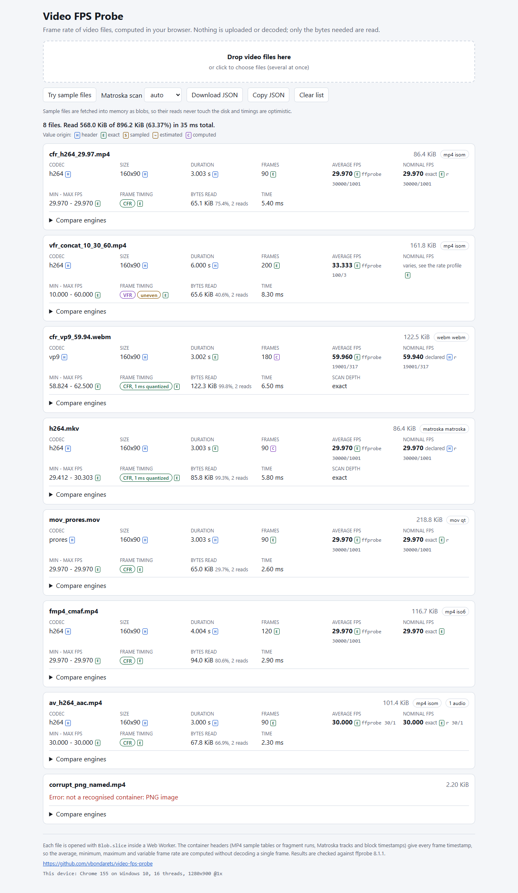
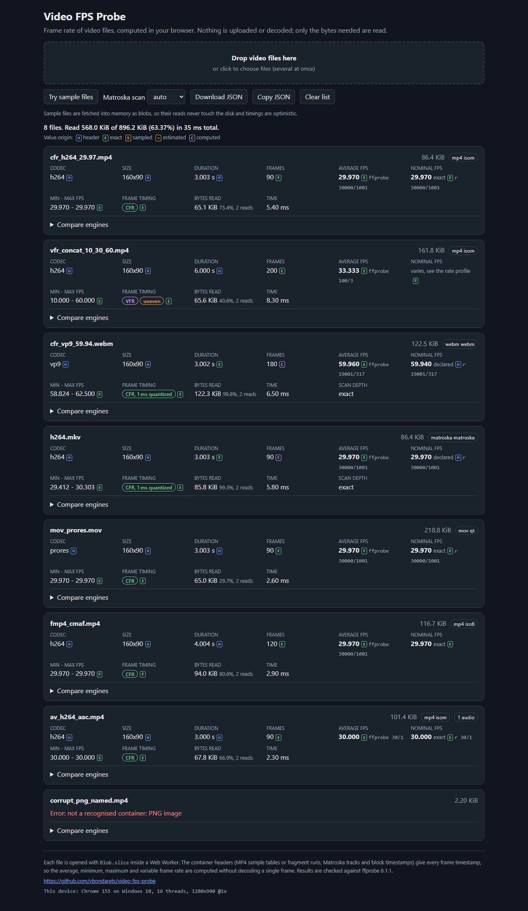
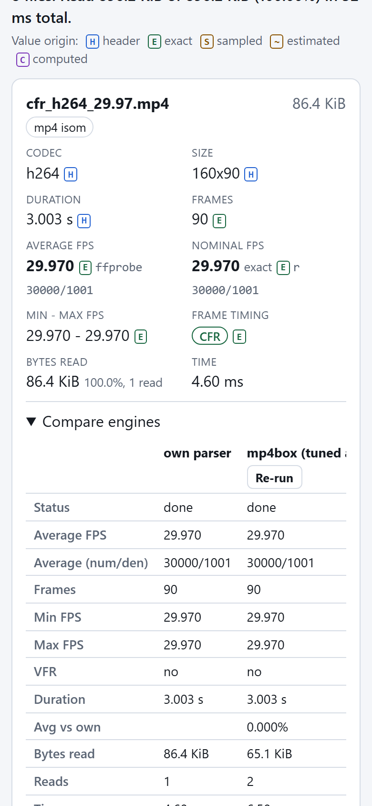
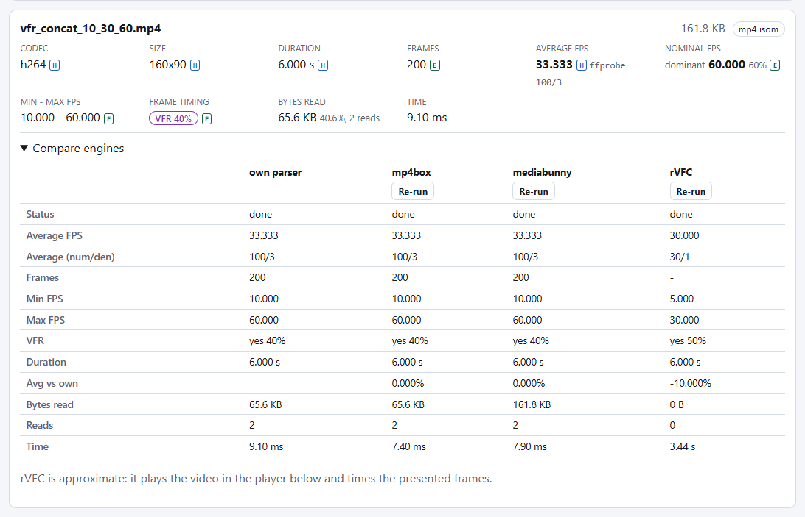

# Demo

**[vbondarets.github.io/video-fps-probe](https://vbondarets.github.io/video-fps-probe/)**: drop your own files or press "Try sample files". Everything runs in the page; nothing is uploaded.

The demo is a React app that shows every value the package computes, lets a visitor try every entry of the package, compares the engines on the same file, and exports the results as JSON. It is not part of the npm package: the package's `files` list holds only `dist/` and the changelog, so the demo never changes what a host installs or ships.

<p>
  
  
  
</p>
<p>
  
</p>

## What it shows

Five tabs, each opened by its address (`#header`, `#url`, `#check`, `#errors`, also when the address changes in an open page) and each with a short explanation and a **Code** box that holds a browser and a Node server version of the call, with a Copy button. The code follows the settings of the tab, apart from the color and aspect checkbox of Check rules: a check preset is named in it only while the rules in the editor still equal the preset with the chosen `sizeBasis` and `hdr`, and edited rules turn it into code that loads the rules as JSON. `tests/e2e/snippets.test.ts` runs the Node versions on Matroska and MP4 fixtures and compares them with the library, and compiles every variant against the published types (the declarations `tsc -p tsconfig.lib.json` emits, laid out as the package): the browser code with the DOM library, the Node code without it, and with `skipLibCheck` only where it imports the root entry, as [the API](../docs/api.md#in-thread-analyze) recommends.

- **Files**: the full analysis described below.
- **Header only**: `analyzeHeader` from `video-fps-probe/header` on every file of the list, in the page, with editable `maxBytes`, `maxReads`, `maxMs`, `maxTracks` and `maxTopLevelBoxes` (presets for the defaults, the tight server configuration of the API docs and a tiny one that ends in `byte-limit`), `fragmentedDuration`, and `color` and `aspect`. Each card shows the read plan (reads, bytes requested and read, time), the layout, the error code with its class, and the coded warnings. Every change reads the files again.
- **From a URL**: `openRangeSource(httpRange(url))` from `video-fps-probe/url`, then `analyzeHeader` or the full analysis in the page, with the samples of the page as ready same-origin URLs. The card counts the HTTP requests, which equal `io.reads` in header mode, while the full analysis reads a small file whole in its first read and so takes one request more than the 64 KiB reply that learned the size. A note explains what another host needs: CORS for the page, uncompressed `206` replies to `Range`, and `Content-Range` in `Access-Control-Expose-Headers`. The timeout of 30 s uses one `AbortController` and a timer, since `AbortSignal.any` and `AbortSignal.timeout` are above the browser floor of the package. The dev and preview servers serve `.mkv` as `video/x-matroska`, as GitHub Pages does, so they neither compress the ranged replies nor leave the type empty.
- **Check rules**: `check()` with the six presets or custom JSON rules in an editor, with selects for `sizeBasis` and `hdr`, over every analyzed file. Each report shows the verdict, the violations with their expected and actual values, the `unknown` hints and the suggested frame rate. A checkbox judges the results without `withColor` and `withAspect`, to show the hints that ask for them, while the code keeps both, since an HDR or display size rule needs them.
- **Error codes**: every `FileErrorCode` with its `errorClass` and meaning, the classes, and every `WarningCode`. The sample `mov_trailing_junk.mov` shows a coded warning in the Files and the Header only tabs.

Each file gets a card with:

- **Average FPS**: presented frames over the presentation span, so it agrees with the Frames and Duration on the same card, next to the exact `avg_frame_rate` rational ffprobe would print when that can be reproduced. The two differ only when the stored durations do not tile the timeline (an edit list that trims a VFR file, a lost or overlapping fragment, a held first frame). The JSON export keeps every rate as an exact rational.
- **Nominal FPS**: the exact rate when every frame interval is equal, a standard rate (such as 30000/1001) when CFR timestamps jitter by a tick or by 1 ms, the declared Matroska rate, or the dominant rate of a VFR track with its share of frames. When the rate profile calls the track uneven, the cell says "varies" instead. ffprobe's `r_frame_rate` is shown next to it when it can be reproduced.
- **Minimum and maximum FPS** from the longest and shortest frame interval.
- **Frame timing**: CFR, CFR with 1 ms quantized timestamps (Matroska, and MP4 remuxed from Matroska), "no VFR in sample" after a Matroska probe, or VFR with the share of intervals that differ from the median (left out for an uneven track). A freeze or gap count badge appears next to it when the profile finds stalls in an otherwise steady track.
- A **rate profile** for timelines whose frame intervals are not all equal: steady and variable segments, rate changes, freezes, gaps and bursts, an `uneven` badge and a sparkline of the frame rate over time ([rate profile](../docs/benchmarks.md#rate-profile)).
- Frame count (presented frames, plus stored samples when an edit list hides some), duration, codec, dimensions, rotation and duplicate timestamps.
- Bytes read, number of reads and analysis time. For Matroska also the scan depth (header, probe or exact) and a "Scan all frames" button.
- A provenance mark on each value (header, exact, sampled, estimated, computed) and warnings in plain words.
- With `codecConfig: true`, then `withColor` and `withAspect` in the page: the color primaries, transfer, matrix and range as ffprobe prints them, HDR (PQ or HLG), Dolby Vision, the bit depth, the profile and the codec string, the sample and display aspect ratio and the display size, then the median frame interval, whether the track is enabled, the layout of an MP4 or MOV file, the error code with its class and meaning, and the warning codes. The `codecConfig` bytes are dropped once they are read, so the JSON export holds plain values.
- All video tracks of the file, primary track first.
- A **Compare engines** panel that runs the same file through mp4box.js and mediabunny, labelled as tuned adapters because they are this package's adapters over each library ([benchmarks](../docs/benchmarks.md#accuracy-vs-ffprobe)), and, on request, a playback estimate with `requestVideoFrameCallback`.

Many files can be dropped at once (two workers, cancel per file). The toolbar sets the Matroska scan mode and downloads or copies everything as JSON: the full results, and once their tabs have run, the header-only results with their settings (`header`), the URL results with their request counts (`url`) and the check reports with their rules (`check`). The export carries the build (`app.build`, the hashed entry chunk of the page) and an `environment` block (browser, OS, CPU threads, screen, time zone) so results from different devices and deploys can be compared, and the footer shows the same device line. Light and dark themes follow the system, and the layout works at phone width (360 px with the Compare panel open, and every tab, are e2e checks).

The eleven sample files are copies of committed fixtures: six for the frame rate (CFR, VFR, fragmented, an edit list, WebM and a VFR Matroska remux), and `hdr10_hevc10.mp4` (PQ), `dv_p81_dvvc.mp4` (Dolby Vision profile 8.1), `sar_h264_4x3.mp4` (a 4:3 sample aspect ratio, 1440x1080 stored and 1920x1080 displayed), `track_disabled.mp4` (a disabled track) and `mov_trailing_junk.mov` (bytes after the last box, the coded warning `trailing-data`). `tests/e2e/capabilities.spec.ts` checks the values the demo shows for them against the committed ffprobe 8.1.1 references, and fails on any console warning or error, page error or unhandled rejection in every flow.

## Running it

From the repository root (Node 22.12 or newer, `npm ci` once):

```
npm run dev            # Vite dev server for demo/, with the library from src/
npm run build:demo     # tsc -b, then vite build to demo/dist/
npm run preview        # serve demo/dist/ with vite preview
npm run size           # chunk sizes and budgets of demo/dist/, writes report/size.*
npm run test:e2e       # build to .playwright/dist and run tests/e2e in Chromium, Firefox and WebKit
```

All of them use `demo/vite.config.ts`, whose root is this folder. `npm run size -- --check` exits 1 when a budget is exceeded; CI runs it. The budgets and their reasons are in [report/size.md](../report/size.md); they apply to the demo only.

## How it uses the package

The demo imports the library by package name, as a host app would:

- `ui/store.ts` holds `lazyProbeFrom(() => import('./probe.ts').then((m) => m.probe))` from `video-fps-probe/client/lazy`, so the page load carries only the stub.
- `ui/store.ts` asks every analysis for `codecConfig: true` and applies `withColor` and `withAspect` from `video-fps-probe/color` and `video-fps-probe/aspect` in a lazy chunk (`ui/meta.ts`) that loads while the worker reads the file.
- The tabs other than Files are lazy chunks: `ui/HeaderPanel.tsx` imports `video-fps-probe/header`, `ui/UrlPanel.tsx` `video-fps-probe/url` and, for the full analysis of a URL, `ownEngine` from `video-fps-probe/worker-runtime` in the page, and `ui/CheckPanel.tsx` `video-fps-probe/check` and `video-fps-probe/presets`.
- `ui/probe.ts` calls `createProbeClient` from `video-fps-probe/client` with a custom worker, `engines: [rvfc()]`, `workers: 2` (drag and drop of many files) and `idleTimeoutMs: 0`.
- `ui/probe.worker.ts` is that worker: `serveProbeWorker` from `video-fps-probe/worker-runtime` serving own, and mp4box and mediabunny through `import()` of `video-fps-probe/engines/*`. The build therefore has exactly one worker file.
- The other modules import only types from `video-fps-probe`.

`scripts/src-aliases.mjs` maps every package entry to its file in `src/`, derived from the `exports` map of `package.json`. `demo/vite.config.ts` uses the map as `resolve.alias`, `tsconfig.app.json` mirrors it as `paths`, and vitest uses it too; `npm run check:aliases` fails when they drift. So the demo always runs the library source of the same commit, through the same entry points a consumer uses. `demo/package.json` keeps the demo modules out of the root `sideEffects` list.

The same setup, installed from the packed tarball instead of the source, is measured and tested by the consumer fixtures in `tests/consumers/fixtures/` ([bundlers.md](../docs/bundlers.md)).

## Deploying to GitHub Pages

The demo is deployed from `main`; there is no separate demo branch. [pages.yml](../.github/workflows/pages.yml) runs `npm run build:demo` on every push to `main` (and on a manual run), with `VITE_BUILD_TIME` and `VITE_COMMIT` set so the JSON export names the build (they go into `index.html` as meta tags, not into the chunks, so a deploy without code changes keeps every chunk name; `npm run check:stable-chunks` builds the demo twice with different values and fails when any other file differs, and CI runs it), and deploys `demo/dist/` through the GitHub Pages actions. The `github-pages` environment allows deployments from `main` only. [ci.yml](../.github/workflows/ci.yml) runs the same demo build, its size budgets and the e2e suite in Chromium, Firefox and WebKit on every push to `main` and every pull request against it. To roll back, re-run an earlier Pages workflow run: it builds and deploys that run's commit again.

Every deploy replaces the whole site, so a tab opened before it asks for chunk and worker names that are gone ([deploy skew](../docs/bundlers.md#deploy-skew)). When an analysis fails with `reason: 'load'`, or a result's error says that a parser chunk did not import (a worker that ran before the deploy asks for a parser it has not loaded yet), the page fetches its own URL without the HTTP cache and compares the entry script there with the running one. If they differ, it shows one banner, "A new version of this page was deployed. Reload to continue.", with a Reload button, and the files read "Not analyzed." instead of an error each; if not, each file reads `Worker could not be loaded:` with the error message. A chunk of the page itself that fails to load (the rate profile or compare panel, the device info, the sample loader) runs the same check through Vite's `vite:preloadError` event, and a missing panel reads "Panel failed to load." with a Retry button that imports it again, instead of taking the page down. Chromium and WebKit fetch the chunk again on Retry; Firefox can keep the failed fetch in its module map until the page reloads ([whatwg/html#10327](https://github.com/whatwg/html/pull/10327)), so its e2e retry test is skipped.

First-time setup (done once for this repository):

1. Create the public repository on GitHub and push `main`.
2. In the repository, open **Settings > Pages** and set **Source** to **GitHub Actions**. Without this the first deploy job fails, because `actions/configure-pages` does not switch Pages on by itself.
3. Wait for the **Pages** workflow to finish (the Actions tab), then open https://vbondarets.github.io/video-fps-probe/ and press "Try sample files".
4. Run the e2e suite against the live demo and keep the result:

   ```
   E2E_BASE_URL=https://vbondarets.github.io/video-fps-probe/ npx playwright test
   ```

5. Check the **CI** workflow run: its e2e job runs the suite in Chromium, Firefox and WebKit on Ubuntu.

## Testing on your devices

The [demo](https://vbondarets.github.io/video-fps-probe/) runs fully in the page, so any device with a browser can test it; nothing is uploaded.

1. Open the demo on macOS (Safari and Chrome), an iPhone (Safari) and an Android phone (Chrome). Press "Try sample files" once: eleven results without an error mean the page works on that device.
2. Pick these files, recorded fresh where possible:
   - an iPhone camera video (HEVC in MOV), also 60 fps and slow motion if available;
   - an iOS screen recording;
   - an Android camera video (MP4);
   - an Android or OBS screen recording (variable frame rate);
   - a WebM from a browser recorder (any MediaRecorder-based recorder, for example a web meeting or screen recorder);
   - a long video (10 minutes or more).
3. For each file check: a result and no error, a time in milliseconds, frames and average FPS that look right, and for screen recordings an `uneven` badge only where the rate really changes (open the rate profile under the card).
4. Press **Copy JSON** (or **Download JSON**) and send the text back. It carries the results plus an `environment` block (browser, OS, CPU threads, screen) and the Matroska scan mode, so the devices can be compared.
5. Compare with ffprobe on a Mac (`brew install ffmpeg`), on the same files:

   ```
   ffprobe -version | head -1
   ffprobe -v error -show_streams -show_format -count_frames -count_packets -show_optional_fields always -of json IMG_0001.MOV > IMG_0001.MOV.ffprobe.json
   ```

   This is the probe the fixture references use. Compare `avg_frame_rate` with the ffprobe string under Average FPS, `nb_frames` (MP4, MOV) or `nb_read_packets` (WebM, MKV) with Frames, and `r_frame_rate` with the `r` value under Nominal FPS. The references here are pinned to ffprobe 8.1.1; a newer ffprobe can differ on edge cases, so send its version line too.

On iPhone, Safari may hand the page a converted copy when a video is picked from Photos. If `size` in the JSON differs from the file on the Mac, pick the file through Files instead, or set the format to Current in the Photos picker options, and note which one you used ([report/average-user.md](../report/average-user.md)).
